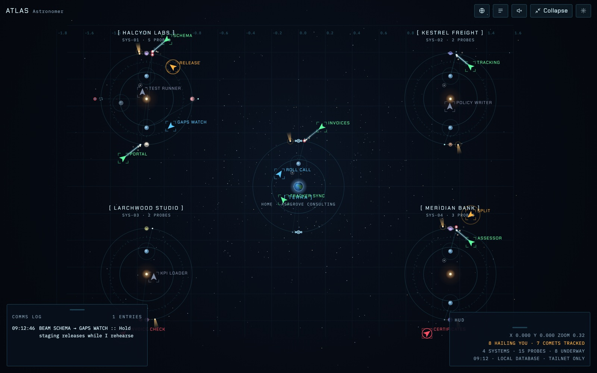
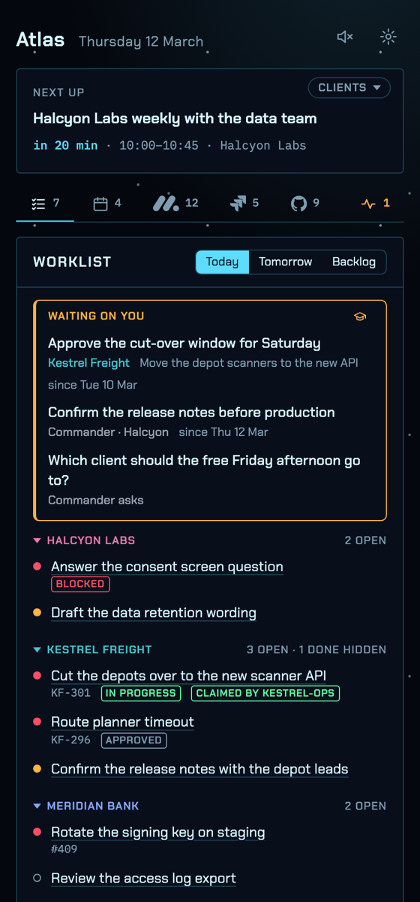

# Atlas

A live map of your AI agents, your clients and the work between them, drawn
as a world you choose.

Atlas shows groups of agents (Claude sessions on several accounts, Gemini,
n8n workflows, scripts), which client each one works for, and the
requirements, backlog items, open questions and decisions they connect to.
It is the graphical, game-like interface for a task database you own, on a
machine you own, reachable only inside your own private network.

| World      | Home          | Clients      | Agents    | Open questions       | Decisions          |
| ---------- | ------------- | ------------ | --------- | -------------------- | ------------------ |
| Astronomer | Terra         | star systems | probes    | comets               | charted stars      |
| Mariner    | Turtle Bay    | islands      | vessels   | fog banks            | lighthouses        |
| Woodsman   | Base Camp     | clearings    | scouts    | unmarked forks       | blazed trees       |
| Gardener   | The Homestead | beds         | bees      | dandelion clocks     | trellises          |
| Samurai    | The Castle    | clans        | retainers | scouts' reports      | seals              |
| Doctor     | The Practice  | hospitals    | staff     | pending test results | recorded diagnoses |

Astronomer and Mariner are the first release; the other four are built and
in Storybook. See [Worlds](docs/worlds.md).

## Screenshots

The full page in Astronomer:



The sidebar in Astronomer:



Both screenshots come from Storybook, with the invented clients.

Status reads the same in every world: green running, blue watching, amber
needs you, red blocked, grey idle. Animation comes from real events (agents
messaging each other, status changes, events from GitHub, CI, calendars and
trackers), and sound plays only when you turn it on.

## Status

In use. The pieces are:

- the data model and six worlds;
- the full page, served by `apps/server` on a machine you own;
- the sidebar, `apps/sidebar`, which builds to one HTML file for the Claude
  artifact, the phone and the VS Code view.

Everything is built and tested in Storybook. See
[Architecture](docs/architecture.md).

## Quick Start

```sh
if ! command -v mise &>/dev/null; then
  if command -v brew &>/dev/null; then brew install mise; else curl https://mise.run | sh; fi
fi
mise install && task setup && task storybook
```

## Stack

- **Runtime:** Bun, TypeScript 6 (strict)
- **Validation:** Zod
- **UI:** React 19, a canvas renderer per world, Storybook 10
- **Tests:** `bun test`; stories as browser tests through Vitest and Playwright, with axe
- **Tooling:** Turbo, go-task, mise, Trunk, Husky
- **CI:** GitHub Actions on hosted runners, CodeQL, dependency review,
  OpenSSF Scorecard, Storybook on GitHub Pages, Release Please

## Privacy

Atlas is for client work, so the repository holds none. Every example runs
on an invented consultancy and four invented clients. Commits are scanned
for client names before they exist, and again in CI. See
[No Client Content, Ever](.claude/rules/client-content.md).

## Related

- [lekman/ai-toolkit](https://github.com/lekman/ai-toolkit) holds the rest of
  the setup:
  - the planner VS Code extension (`packages/vscode-planner`), which shows the
    sidebar in a VS Code view;
  - the tasks server (`packages/tasks-mcp`), which holds the worklist;
  - the [live dashboard](https://github.com/lekman/ai-toolkit/tree/main/practices/live-dashboard)
    practice, with the sync scripts and the local MCP server the sidebar reads.

## Contributing

See [Contributing](docs/CONTRIBUTING.md) and [Security](SECURITY.md).

## Licence

[MIT](LICENSE)
