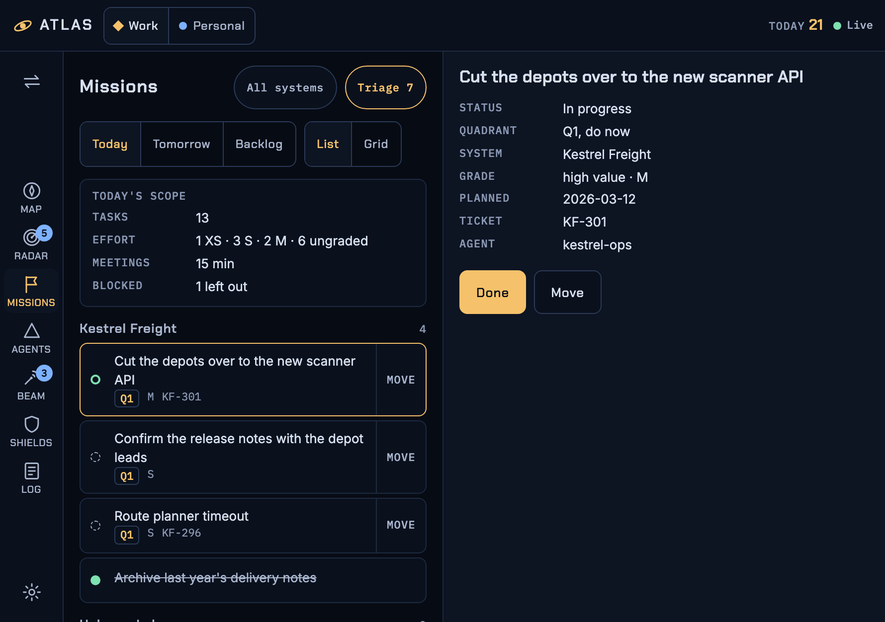
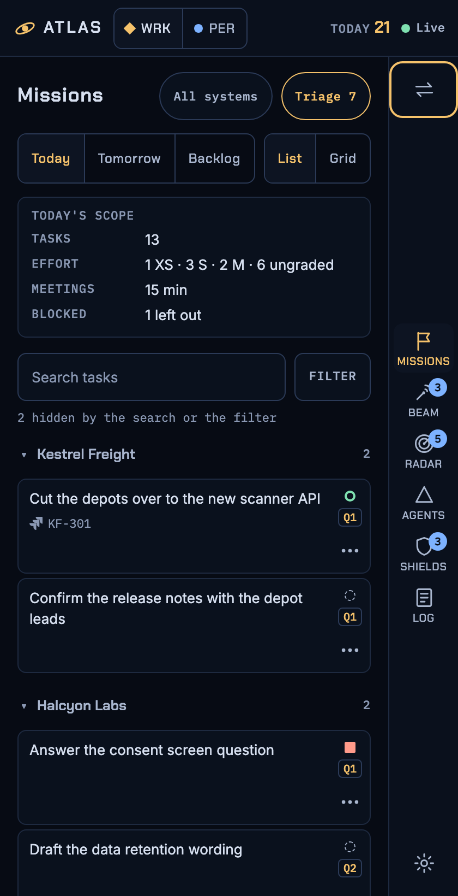

# Atlas

Atlas is a personal console for someone who works across several clients with
AI agents. It shows your work for the day, the agents doing part of it, and
what is waiting for your answer, in one dark view built for a phone, a laptop
or a sidebar.

Atlas is personal. Shared work stays in Jira, GitHub or Monday. Atlas keeps a
pointer to each shared item together with your own grade, effort and notes. It
runs on a computer you own and is reachable only inside your own private
network.



The screenshots use invented clients.

## What You Can Do

| Section  | What it holds                                                   | Status    |
| -------- | --------------------------------------------------------------- | --------- |
| Missions | Today, tomorrow and the backlog, by client or by Covey quadrant | Available |
| Triage   | Grading new tasks by value and effort, one at a time            | Next      |
| Beam     | Approvals and questions from your agents, answered in place     | Planned   |
| Agents   | Every agent by the machine it runs on, and what it is doing     | Planned   |
| Radar    | Alerts, tickets and meetings that are not yet your work         | Planned   |
| Shields  | Host health, the link to your server, and each integration      | Planned   |
| Log      | Scores by day and week, and completed work                      | Planned   |

In Missions you can:

- see the day's scope, which is the number of tasks, their effort by size,
  meeting time and the blocked tasks left out (Atlas sets no limit, because
  what fits a day is your call);
- narrow the list to one client with the scope button;
- open a task, mark it done, or move it to today, tomorrow or the backlog.

On a phone away from your server, moves are queued and applied when the
server is back. The top bar always says which state you are in: Live, Stored
copy, or Queued with a count.

## Where It Runs

Atlas lays itself out from the space it is given, so one page serves:

| Where                              | Layout                                          |
| ---------------------------------- | ----------------------------------------------- |
| A sidebar beside a Claude artifact | One pane, the list or the task with a back link |
| A folding phone, closed            | One pane                                        |
| A folding phone, open              | The list and the task meet at the fold          |
| A laptop browser                   | The list at reading width, the task beside it   |



The menu sits on one edge of the screen. The swap button at its top moves it
to the other edge, and Atlas remembers your choice for each layout.

## Install

### What You Need

- A computer that stays on, to run the Atlas server. Atlas is used on macOS.
- [Tailscale](https://tailscale.com) on that computer and on every device you
  open Atlas from. Atlas is never exposed to the internet.
- [Bun](https://bun.sh) 1.3 and Git.
- The local dashboard server from the
  [live dashboard](https://github.com/lekman/ai-toolkit/tree/main/practices/live-dashboard)
  practice in lekman/ai-toolkit. Atlas reads your worklist through it.

### Steps

1. Get Atlas.

   ```sh
   git clone https://github.com/lekman/atlas.git
   cd atlas
   bun install
   ```

2. Describe your clients. Copy the example configuration and replace the
   invented clients with your own. Keep the file outside the repository.

   ```sh
   cp apps/sidebar/sidebar.config.example.json ~/atlas.config.json
   ```

3. Build the page with your configuration.

   ```sh
   (cd apps/sidebar && SIDEBAR_CONFIG=~/atlas.config.json bun run build:console)
   ```

4. Start the server. Point it at the page and at the command that starts the
   dashboard server.

   ```sh
   ATLAS_CONSOLE_FILE="$PWD/apps/sidebar/dist-console/console.html" \
   ATLAS_DASHBOARD_MCP_COMMAND="python3 /path/to/dashboard_mcp.py" \
   bun run --cwd apps/server start
   ```

   The server listens on `127.0.0.1:7400`. Set `ATLAS_PORT` to use another
   port.

5. Share it on your tailnet.

   ```sh
   tailscale serve --bg 7400
   ```

6. Open `https://<computer>.<tailnet>.ts.net/console` on your phone or laptop.
   On a phone, add it to the home screen.

To keep Atlas running after a restart, start the command in step 4 from a
launchd agent on macOS or a systemd service on Linux.

### In the Claude Desktop App

The built page is a single HTML file. You can publish
`apps/sidebar/dist-console/console.html` as a Claude artifact and keep it open
in the sidebar beside your chat. In the desktop app the page reads your
worklist through the same local dashboard server. Declare it as
`host:dashboard`, with the tools `worklist`, `task_done`, `task_move` and
`commander_requests`.

## Privacy

Your tasks, clients and notes stay on your own computer and travel only
inside your tailnet. The repository holds no client content. Every example
uses an invented consultancy and four invented clients.

## Building or Changing Atlas

See [Maintainers](MAINTAINERS.md).

## Licence

[MIT](LICENSE)
