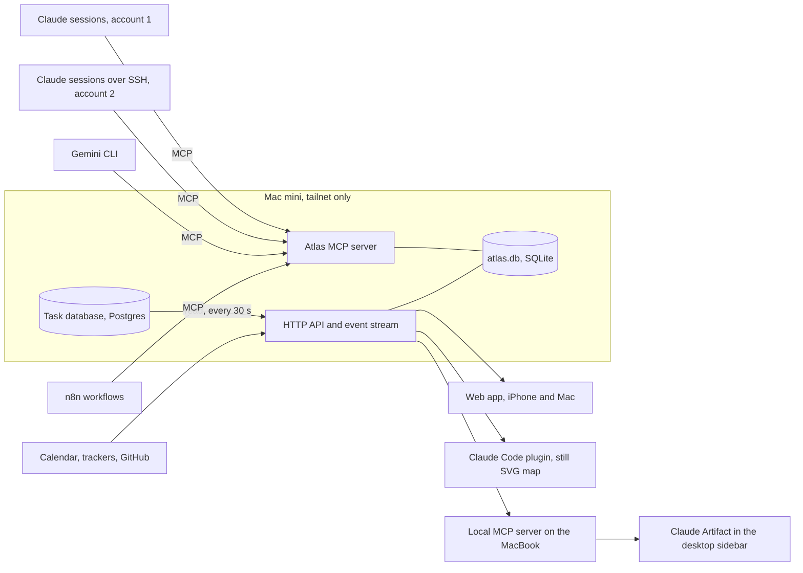

# Architecture

Atlas is the graphical, game-like interface for your work: it draws
agents, clients and tasks as a world you choose. Since 24 October 2026,
tasks are kept in a separate task database (Postgres on the Mac mini, see
[the plan](plan.md#direction-24-october-2026)). Atlas reads clients,
workstreams and tasks from it, as described in "The Task Source" below.
Atlas's own SQLite file keeps agents, the event log, the score and machine
tokens, and the records of clients the task database does not hold yet.



## What Exists Today

| Package           | Status                                                 |
| ----------------- | ------------------------------------------------------ |
| `@atlas/core`     | Built. Model, events, needs-you, boundary rules, tests |
| `@atlas/fixtures` | Built. Invented dataset and a scripted day             |
| `@atlas/worlds`   | Built. Six worlds: layout, canvas, SVG, sounds         |
| `@atlas/ui`       | Built. Shell, live map, panels, stories                |
| `apps/storybook`  | Built. Story tests with axe; published to GitHub Pages |
| `apps/server`     | Started. SQLite, task source, API, stream and MCP      |
| `apps/web`        | Started. The full view, kept live by the event stream  |
| `apps/artifact`   | Next                                                   |
| `apps/plugin`     | Later                                                  |

## The Data Model

Every record carries a **classification** (public, internal,
client-confidential, restricted) and a **boundary** (where it may live).
One client is marked **home**: your own business, drawn at the centre of
every world.

| Record       | Holds                                                                                                                    |
| ------------ | ------------------------------------------------------------------------------------------------------------------------ |
| Client       | Name, whether it is home                                                                                                 |
| Account      | A login an agent runs under, and its runtime (Claude, Gemini, n8n, script)                                               |
| Agent group  | A group of agents serving one client                                                                                     |
| Agent        | Account, host, how it can be reached, status, what it works on, a note, the agent it was launched from if it is a vessel |
| Requirement  | What a client needs to be true                                                                                           |
| Workstream   | A subject a client's work is grouped under, and its place among the others                                               |
| Backlog item | Work, optionally serving a requirement and in a workstream, with state and development tracking                          |
| Question     | What blocks a requirement or item, and who must answer                                                                   |
| Decision     | What was decided, what it settles, the question it came from                                                             |

A backlog item may carry **development tracking** (`development`): where
the code for it stands. Each of its three parts is optional, because work
often has an issue before it has a branch, and a branch before it has a
pull request.

| Part          | Holds                                                                         |
| ------------- | ----------------------------------------------------------------------------- |
| `issue`       | The GitHub issue: key, address, `open` or `closed`. It may repeat the tracker |
| `branch`      | The branch name, and the git worktree's path when the work is on one          |
| `pullRequest` | Number, address, `draft`, `open`, `merged` or `closed`, and its checks        |

Checks are `passing`, `failing`, `pending` or `none`. The SQLite store
does not keep development tracking and the task database does not have it.
It comes from gh-events, as described under "GitHub State", and otherwise
from the invented fixtures and the fake values described under "The
Server".

The map draws a backlog item only when it is in progress or in review, or
planned for a day and not done. Each workstream draws at most five of
those, the most urgent first, and counts the rest on its marker. Work
with no workstream gathers at an "Unsorted" marker. Unscheduled and done
work stays in the data for lists and the day plan.

Everything that changes the picture is an **event**: a message between
agents, an event from an outside system, a status change, a question
answered, a vessel launched or returned. The same event drives the
database write, the animation, the log line and the sound.

A **launch vessel** is an agent with a parent: a background agent or
subagent another agent started. `agent-launched` adds it in its parent's
group, account and host, running, with no way to reach it, working the
items it names. `agent-returned` removes it. A launch is refused when the
parent is missing or is itself a vessel, when the new id is already taken
by any record, or when an item it names is missing. A return is refused
for an agent that is not a vessel.

## Boundaries

What decides a boundary is **which model sees the data**, not where the file
sits. An email read by an agent signed in to your own Claude account has
left the client's boundary even if no file moved.

- An agent that reads client content runs inside the client's boundary,
  under the AI the client has approved.
- Records cross a boundary only as a **card**: id, kind, client, a title
  written for the destination, state, classification, and an opaque
  reference back. `exportCard` in `@atlas/core` enforces the shape and
  rejects a title that still holds an email address, a phone number, a long
  identifier or a URL with a query string.
- A destination that may not hold a record's classification gets only a
  "withheld" marker, so a restricted record shows as a count, never a title.

## The Server

`apps/server` holds the database, the HTTP API, the event stream and the
MCP endpoint, and serves the web app from `apps/web` at `/` on the same
origin. Machine tokens, Litestream and the import are still to come.

| Route                    | What it does                                                 |
| ------------------------ | ------------------------------------------------------------ |
| `GET /api/health`        | Whether the server is up, its version, and its source counts |
| `GET /api/dataset`       | Every record, and the last event they include                |
| `GET /api/events`        | The event log after `?after=<sequence>`, oldest first        |
| `POST /api/events`       | Adds one event, writes its effect and streams it             |
| `GET /api/stream`        | Server-sent events after `?after=`, then each new one        |
| `GET /api/items/:id/log` | One backlog item's log from the task database, newest first  |
| `POST /mcp`              | The MCP tools, over Streamable HTTP                          |

The dataset response names the last event it includes in the
`x-atlas-sequence` header, and the web app opens the stream from there, so
no event falls between the two. An event and its effect are written in one transaction, so the log and the
records never disagree. The MCP endpoint is stateless and answers in JSON. Its tools write through
the same events as `POST /api/events`, so a tool call reaches the log and
every open view.

| Tool                  | What it does                                                           |
| --------------------- | ---------------------------------------------------------------------- |
| `list_agents`         | Every agent with its id, client, host and status, and unknown claimers |
| `report_status`       | Sets the agent's status and note: a `status-change` event              |
| `send_message`        | A message between two known agents: an `agent-message` event           |
| `list_my_work`        | The agent's own work, then its client's open work, most urgent first   |
| `list_open_questions` | Open questions, with who must answer                                   |
| `answer_question`     | Answers a question and records the decision                            |
| `launch_vessel`       | Adds a vessel launched from an agent: an `agent-launched` event        |
| `return_vessel`       | Removes a vessel that has finished: an `agent-returned` event          |

A session connects as described in "Who May Connect", below. A request with an Origin header from another site is refused, so a web page
cannot call the tools through a browser on the tailnet.

An event about a missing record is refused with a
404, and a second answer to the same question with a 409. A launch from a
missing parent is a 404; a launch onto a taken id, or the return of an
agent that is not a vessel, is a 409. A posted event
must be `application/json`: another site cannot send that from a browser
without a preflight, and the server answers no preflight. Until machine
tokens exist, any device on the tailnet may post an event.

The server listens on 127.0.0.1:7400 unless `ATLAS_HOSTNAME` and
`ATLAS_PORT` say otherwise. The database file is
`~/Library/Application Support/Atlas/atlas.db` unless `ATLAS_DATABASE`
names another. `ATLAS_SEED=fixtures` seeds the invented dataset into an
empty database. `ATLAS_SEED=<path>.json` seeds a whole dataset from a file
instead, checked against the core schema. A file with real clients is built
on the Mac mini from the vault and kept outside this repository.

`ATLAS_FAKE_DEVELOPMENT=true` shows invented development tracking on
items that GitHub state does not cover. It is off unless set to exactly
`true`.
When on, every backlog item whose tracker is GitHub and that has no
development tracking gets values worked out from its id, tracker key,
title and state, so the same item shows the same values on every read:

| Item state | Invented tracking                                                                                                                                   |
| ---------- | --------------------------------------------------------------------------------------------------------------------------------------------------- |
| To do      | The tracker's issue, open                                                                                                                           |
| Doing      | The issue, a branch `feature/<number>-<slug>` on a worktree, and in most cases a draft or open pull request with checks pending, passing or failing |
| In review  | The issue, the branch on a worktree, and an open pull request                                                                                       |
| Done       | The issue closed, the branch, and a merged pull request with passing checks                                                                         |

The values are laid over `GET /api/dataset` only. They are never written to
SQLite, never sent to MCP tools, and never replace tracking an item already
has. `GET /api/health` reports `development: "fake"` while the setting is
on, so nobody mistakes the values for real ones.

### The Task Source

With the task database configured, the server reads its clients,
workstreams and tasks (the `client`, `workstream`, `dashboard_item` and
`item_history` tables) and lays them over SQLite. Every setting is
optional; without `ATLAS_TASKS_HOST` the server serves SQLite alone, as
before.

| Variable                       | What it sets                                                     |
| ------------------------------ | ---------------------------------------------------------------- |
| `ATLAS_TASKS_HOST`             | The Postgres host. Setting it turns the task source on           |
| `ATLAS_TASKS_PORT`             | The port, 5432 unless set                                        |
| `ATLAS_TASKS_DATABASE`         | The database. Needed with the host                               |
| `ATLAS_TASKS_USER`             | A read-only role. Needed with the host                           |
| `ATLAS_TASKS_PASSWORD_COMMAND` | A command that prints the password, such as a Keychain query     |
| `ATLAS_TASKS_POLL_SECONDS`     | Seconds between reads, 30 unless set                             |
| `ATLAS_TASKS_CLIENTS`          | Only these client ids, joined by commas; every client unless set |

The password command runs without a shell: the value is split on spaces,
with quotes holding an argument together, and nothing in it is expanded.
Its output is trimmed and never logged. If it fails, as it can while the
Keychain is locked after a restart, it runs again on the next read.

The merge works one client at a time:

- For every client the task database holds, its client row, workstreams
  and tasks come from the task database and replace SQLite's records for
  that client. A client only the task database holds is added.
- Every other client keeps its SQLite records. Agents, groups, accounts,
  requirements, questions and decisions always come from SQLite.
- The home client in SQLite stays home.
- An agent's `workingOn` follows the task database's claims: the items whose
  `claim_by` names it and that are not done, earliest `claim_at` first. A
  claim names an agent by its id or its name, whatever the case; an id match
  wins over a name match. Items of clients the task database does not hold
  keep their place from SQLite, after the claims.
- A claim that names no agent is never turned into one. Health counts them
  under `tasks.unknownClaimers`; the names they used are only in the
  `list_agents` reply, which needs a token, so the claimer can be told its
  Atlas id.
- Dropped tasks are left out. A row that does not match the core model is
  skipped and counted. A reference that the swap breaks (an agent working on
  a task that is gone, a question that blocks one, a task that names a
  missing requirement or workstream) is removed from the served dataset and
  counted, and a question with nothing left to block is left out.

`GET /api/dataset`, the MCP tools and the checks on a launch all read the
merged dataset, so `list_my_work` shows the same claims and open tasks as
the map.

The server reads the task database once before it listens, then every
`ATLAS_TASKS_POLL_SECONDS`, all in one read-only transaction. When a read
changes the records, the event stream sends `event: refresh` with no id,
so a page's place in the event log stays where it was, and the web app
loads the dataset again. The `atlas` events are unchanged. If the task
database cannot be reached, the server still starts and serves SQLite
alone, logs one line with the error code, and tries again on the next
poll. After a good read, a failed one keeps the last good records.

`GET /api/health` reports the task source as counts only: `source`
(`postgres` or `none`), `clients`, `items`, `skipped`, `lastRefresh`, `ok`,
`dangling`, `ambiguousClaims` and `unknownClaimers`. Health is open
without a token, so it never names a client, a task or a claimer.

### The Item Log

The task database keeps a log for each item in `item_log`: `item_id`, `at`
(a timestamp with time zone), `status` (`todo`, `doing`, `review`, `done`,
`dropped` or `blocked`), `note` and `by`. Agents write to it as they work an
item, so it holds their responses: what they did, what blocks them, and
when they handed the item on.

The log never joins the dataset. An item's log can be long, and a view
shows only the selected item's, so the server reads it on demand, one item
at a time, in its own read-only transaction:

```text
GET /api/items/<id>/log  →  { "entries": [ { "at", "status", "note", "by"? } ] }
```

- The entries are newest first, at most 200. `at` is ISO 8601, a missing
  note is empty text, and `by` is left out when the row names nobody.
- The id must be an identifier (lower-case words joined by hyphens), or
  the answer is `400` before the task database is asked.
- An item the last good read did not hold answers an empty list: an item
  of a client the task source does not cover, including one left out by
  `ATLAS_TASKS_CLIENTS`. Without a task source the answer is also empty.
- When the task database does not answer, the response is `503`, and the
  server logs one line with the error code and nothing from the row.
- The route follows the same sign-in rule as the rest of `/api`.

A row whose status or time does not match the model is left out of the
answer rather than failing it.

Atlas only reads the task database. Task writes (add, update, claim,
complete) belong to the task database's own tasks MCP server. Atlas's MCP
tools stay for what agents tell the map: agents, status, messages,
questions and vessels.

### GitHub State

Atlas never calls GitHub. A separate process, gh-events, polls GitHub and
writes two files into one folder. Atlas reads them when
`ATLAS_GITHUB_STATE_DIR` names that folder, usually
`~/.local/state/gh-events`. Without the variable, the server behaves as
before.

| File            | What Atlas does with it                                                          |
| --------------- | -------------------------------------------------------------------------------- |
| `registry.json` | Every open pull request and issue gh-events watches. Read every 30 seconds       |
| `events.jsonl`  | One line per change: approved, checks failed, conflict, merged, closed, assigned |

The folder is also watched, so a change is usually read within a second.
gh-events' contract never carries titles, bodies, branch names or logins,
and Atlas checks every item and line against its own schema as well. A
value or an event Atlas does not know is skipped and counted. A
`registry.json` version or a line version other than 1 is refused, and
health says so.

An item matches a GitHub issue when its tracker is GitHub and its tracker
address names the same repository and number, compared without regard to
case. A pull request belongs to an item when it closes the item's issue in
the same repository, or when the item's tracker address is that pull
request. The row's client must be the item's client. A row whose client is
unset or is not an Atlas client is counted as unknown and never shown.

For every item it matches, the reader's values replace any other
development tracking in `GET /api/dataset`:

- `issue` is open while the issue is in `registry.json`, and closed after an
  `issue_closed` event.
- `pullRequest` is `draft` or `open` from the registry, `merged` after a
  `merged` event, and `closed` after a `closed` event (closed without merging). Checks map `SUCCESS` to passing, `FAILURE` and `ERROR` to
  failing, `PENDING` and `EXPECTED` to pending, and no checks to none.
- `branch` stays empty, because the contract has no branch names.

The fake values fill only the items the reader did not match. Like them,
the real values are never written to the records and never reach MCP
tools. When they change, the event stream sends `event: refresh`.

Each new line in `events.jsonl` that matches an item becomes an `external`
event from GitHub about that item, such as "Pull request #148: checks
failed" or "Issue #391 closed". gh-events rotates the log to
`events.<YYYYMMDDTHHMMSSZ>.jsonl`; after a restart the reader finds the file
it was reading by its stored inode under that name and finishes it before
the new `events.jsonl`. The text holds only the event and the
number. The event goes through the same path as `POST /api/events`, so it
reaches the log, the item's log column, the animation and the sound. The
reader follows the file by inode and byte offset, reads only whole lines,
and reads a new file from the start. It keeps the cursor and the keys of
the last 5,000 lines in SQLite, so a restart neither replays a line nor
skips one.

`GET /api/health` reports `github` as counts only: `source` (`gh-events` or
`none`), `ok`, `stale` (the registry is older than three poll intervals),
`error`, `items`, `matched`, `unmatched`, `unknownClients`, `skipped`,
`eventsApplied`, `eventsUnmatched`, `eventsSkipped`, `eventsRefused` and
`lastEventAt`. It never names a repository or a number.

### Live Agent Status

Atlas can set agents' statuses from the Claude Code sessions running on
the Mac mini. `ATLAS_SESSIONS_DIR` names the folder where Claude Code keeps
one `<pid>.json` file per live session, usually `~/.claude/sessions`.
Without the variable, the server behaves as before.

| Variable                      | What it sets                                      | Default |
| ----------------------------- | ------------------------------------------------- | ------- |
| `ATLAS_SESSIONS_DIR`          | The folder of session files; turns the reader on  | Off     |
| `ATLAS_SESSIONS_POLL_SECONDS` | Seconds between reads                             | 5       |
| `ATLAS_SESSIONS_FORGET_HOURS` | Hours a docked agent stays after its session ends | 24      |

The session files are Claude Code's internal state, not a documented
interface, and their shape can change in any release. Atlas keeps only
`pid`, `name`, `status`, `sessionId`, `statusUpdatedAt` and `entrypoint`,
and drops every other field (the working folder included) when it parses
a file. A file that is half written or has another shape is skipped for
that poll. A file can outlive its process, so a session counts only while
its process answers signal 0. Key and socket files beside them are ignored.

A session matches an agent when its name equals the agent's id or name,
without regard to case, or starts with the id or name followed by `-`: roster
agent "Example" is session `example-69`. An exact match beats a prefix, and
a longer prefix beats a shorter one. A session that matches two agents
equally well is ambiguous: it is counted and changes nothing. When several
live sessions match one agent, the most active speaks for it (busy, then
waiting, then idle), then the one whose status changed last.

| Session                  | Agent status | Note                     |
| ------------------------ | ------------ | ------------------------ |
| `busy`                   | running      | "Session busy"           |
| `waiting`                | waiting      | "Session waiting on you" |
| `idle`                   | idle         | "Session idle"           |
| None, after one was seen | idle         | "Session offline"        |

A status changes only when the session's state changes, and then only
when the agent's status differs (or, going offline, its note). It goes
through the same path as `POST /api/events`, as a `status-change` event,
so the log, the animation, the sound and the stream follow. A status an
agent reports through `report_status` stays until its session's state next
changes. An agent no session has ever matched keeps its stored status.
Claims still decide what an agent works on.

A live session that matches no agent is docked at home: Atlas adds an agent
for it to the home client's first group, with the id `session-<name>`
(made unique with `-2`, `-3`), the session's name, this machine's host
name, reach `local`, the first account, and the note "Not in the roster".
When its session ends it goes offline, and after `ATLAS_SESSIONS_FORGET_HOURS`
offline it is removed. Once its name matches a roster agent, the docked
agent is removed and the roster agent follows the session. Adding or
removing a docked agent sends `event: refresh` on the stream. Without a home
group or an account, nothing is docked and health says why.

Which agents follow a session, and each session's last state, are kept in
the `session_agents` table, so a restart still knows to set an agent
offline whose session ended while the server was down.

`GET /api/health` reports `sessions` as counts only: `source` (`files` or
`none`), `ok`, `files`, `live`, `matched`, `unknownDocked`, `ambiguous`,
`skipped`, `lastReadAt` and `error`. It never names a session. `ok` is false
when the folder cannot be read, or when it holds session files and none of
them has the expected shape, which is how a change in Claude Code's format
shows. While `ok` is false, no agent is changed.

The reader sees only the machine Atlas runs on. Sessions on other machines
need a reporter of their own there, still to come; until then they report
through MCP.

### Design

- **Database:** SQLite in WAL mode with Drizzle for schema and migrations.
  Only the server process opens the file; agents go through MCP.
- **MCP tools still to come:** `ask_question` and `link`. Claiming and the
  task tools (`task_add`, `task_update`, `task_complete`) belong to the task
  database's tasks server, not to Atlas.
- **Network:** Tailscale Serve on the tailnet only, with Funnel off. Nothing
  reaches the server from outside the tailnet. People are identified by
  Tailscale's identity headers; agents as below.

### Who May Connect

Agents reach the database only through MCP, then the API, over the tailnet.
Each machine proves who it is twice, and no password is shared between
machines.

| Layer          | What it checks                                                                                                                                     |
| -------------- | -------------------------------------------------------------------------------------------------------------------------------------------------- |
| Tailscale node | The server asks the local Tailscale daemon which node owns the caller's address, as `tailscale whois` does, and reads its stable id                |
| Machine token  | Atlas issues one token for each machine, bound to that node's stable id and scoped to the clients the machine may see. Issuing it again rotates it |

A token copied to another machine fails, because its node does not match.
Only a SHA-256 hash of each token is stored. A wrong, revoked or misplaced
token is refused with a 401, never treated as anonymous, so a broken setup
fails where it can be seen. Behind Serve, the caller's node comes from the
`X-Forwarded-For` address, which is trusted only on a loopback connection.

| Caller                                        | `/api/*`        | `/mcp`                       |
| --------------------------------------------- | --------------- | ---------------------------- |
| A person, through Serve's identity            | Yes             | No                           |
| A machine that may see every client           | Yes             | Yes                          |
| A machine scoped to some clients              | No: it uses MCP | Yes, filtered to its clients |
| Anyone else, while tokens are optional        | Yes             | Yes                          |
| Anyone else, with `ATLAS_REQUIRE_TOKENS=true` | No              | No                           |

`GET /api/health` is always open. Tokens are optional until
`ATLAS_REQUIRE_TOKENS=true`, so every machine can get its token before
anything is refused. Scheduled rotation is not built yet.

Tokens are issued on the Mac mini, against the server's database:

```bash
bun apps/server/src/machine-tokens.ts issue <machine> --node <tailnet name> --clients <client ids, or *>
bun apps/server/src/machine-tokens.ts list
bun apps/server/src/machine-tokens.ts revoke <machine>
```

`issue` prints the token once. On the machine, keep it in the Keychain and
let Claude Code read it with a `headersHelper`, so the token is never written
into a settings file:

```json
{
  "mcpServers": {
    "atlas": {
      "type": "http",
      "url": "https://<server>.<tailnet>.ts.net/mcp",
      "headersHelper": "printf '{\"Authorization\":\"Bearer %s\"}' \"$(security find-generic-password -s atlas-token -w)\""
    }
  }
}
```

Claude Code runs the helper again after a 401, so a rotated token is picked
up without a restart. A session started over SSH may find the Keychain
locked; that machine needs another place for its token.
Every agent on a machine names itself in `report_status`, so the map still
shows each agent apart.

Cloud sessions are never on the tailnet and never connect. They have never
had access to the dashboard either.

`tailscale whois` was checked on Tailscale 1.104.1: it returns the node's
stable id, name, key and key expiry, and the user.

What the server sees of the caller was checked on Tailscale 1.102.4 on the
Mac mini, with a Bun server that echoed its remote address and headers:

| Setup                                            | Remote address      | Caller's tailnet address                                  |
| ------------------------------------------------ | ------------------- | --------------------------------------------------------- |
| Behind `tailscale serve`, listening on 127.0.0.1 | 127.0.0.1           | In `X-Forwarded-For`, with the `Tailscale-User-*` headers |
| Listening on the tailnet address directly        | The tailnet address | The remote address itself                                 |

Serve replaced a forged `X-Forwarded-For` and a forged
`Tailscale-User-Login` with its own values, and `tailscale whois` resolved
the forwarded address to the calling node's stable id. Two limits remain.
The caller in this test was the Mac mini itself, not a second machine. And
behind Serve, any process on the Mac mini can connect to 127.0.0.1 and set
`X-Forwarded-For` itself, so the forwarded address is only as trustworthy
as the processes on that host.

### Versions

The `atlas` plugin comes from the `ai-toolkit` marketplace with automatic
updates on, which is a setting on each machine. Over MCP, a session takes
its tool definitions from the server when it connects, so the tools cannot
fall behind the server; only the skill text can. A long-running session
keeps its skills until it restarts, so the server accepts the previous
tool version for one release and rejects anything older with a message
that says to restart the session.

- **Secrets:** the macOS Keychain. Never in the repository, never in the
  database.
- **Host:** a Mac mini with sleep off, restart after power failure, services
  under launchd, and FileVault on.

### Backups

| Layer      | How                                                                                       |
| ---------- | ----------------------------------------------------------------------------------------- |
| Continuous | Litestream streams every change to an encrypted off-site bucket                           |
| Nightly    | `VACUUM INTO` a snapshot on a local disk and in Time Machine, 30 days                     |
| Weekly     | An automated restore: integrity check, row counts, and a "Backup verified" event in Atlas |

A backup that has never been restored does not count.

## Where Each View Runs

| Where                  | Built from                        | Reaches the data through                                         |
| ---------------------- | --------------------------------- | ---------------------------------------------------------------- |
| iPhone and Mac browser | `apps/web`, a PWA                 | The API over the tailnet                                         |
| Claude desktop sidebar | `apps/artifact`, a one-file build | A local MCP server on the MacBook, then the API over the tailnet |
| Claude Code plugin     | `apps/plugin`                     | The API; shows the still SVG map and the needs-you list          |

**Can the Claude Artifact talk to the database?** On the Mac, yes: the
desktop app lets an artifact call a local MCP server, which forwards to the
API. In the iPhone Claude app, no: local MCP servers are not available
there, and Claude's own servers cannot reach a tailnet. The phone uses the
web app over Tailscale instead.

A Claude Code plugin pane can only draw Claude's own elements (boxes, text,
buttons, SVG). It cannot run the animated canvas, which is why
`@atlas/worlds` also renders a still SVG map.

### Working an Item in the Full View

The full view opens on the whole map with home in the middle, and a click
on empty space returns there. One record is selected at a time, from the
map, the needs-you list or a link. The HUD (heads-up display, the panel in
the bottom-right corner) holds it: a needs-you entry opens in place in the
list, and any other record shows in a Selected section above the list. The
record keeps its buttons (Answer, Dispatch, Ask status and the rest) and
adds Details. The map flies to the record, and to the work a question
blocks, in the space left clear by the log and the HUD.

The log is a column down the left, from under the top bar to the bottom
margin, opposite the HUD and as wide. It is always open and scrolls
inside. On load the web app reads the latest 200 events up to the
dataset's sequence from `GET /api/events`, so the log starts full; the
stream adds each new one. With nothing selected it shows every event,
newest first. With a record selected it narrows to that record and names
it at the top, and All events widens it again without losing the
selection. For a backlog item it merges, newest first:

- the item log from `GET /api/items/<id>/log`, read when the item is
  selected and again when a `refresh` reloads the dataset, and
- the map events about the item: an outside event that names it, a launch
  that works it, a status change or a message from an agent working it at
  the time, a vessel working it coming back, and a question answered that
  blocked it.

Every line shows its time, who it came from and the text, and map events
keep the world's wording. For an agent or a question the log shows the
events about that record the same way. Events read on load are described
against the dataset as loaded, so a status change among them names the
agent's status now, not the one before the change. On a phone the log
stays a short box along the bottom with the latest line.

Details opens a blue glass pane over the map, between the log and the HUD,
with every field of the record, its development tracking, its history, the
records it links to and its details document when one has been imported.
The sections sit in columns that fill the pane: the fields, then Tracking,
then History and Links. They fall to two columns and then one as the pane
narrows, and are always one on a phone. Tracking shows the issue, the
branch (and its worktree) and the pull request, each state as a word in a
label marked in its status colour; links to GitHub open in a new tab. The
HUD shows the pull request on one line: number, state and checks. Escape closes the pane,
then clears the selection, then returns to the compact view. On a phone,
where the HUD has no room, the selected record is a sheet along the bottom
and the pane fills the width above it.
