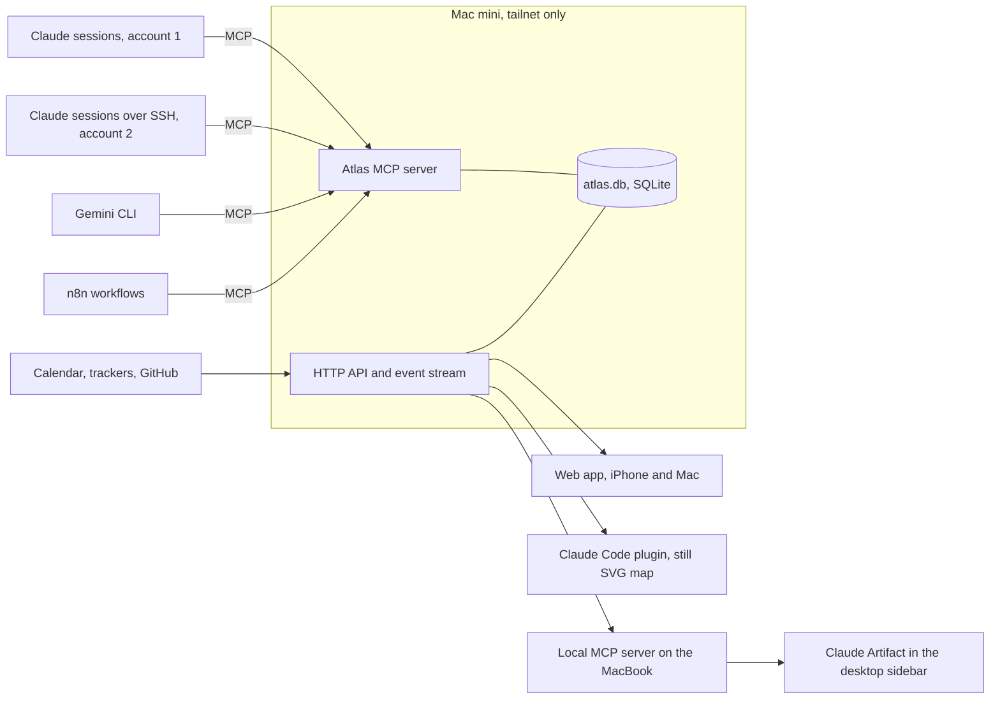

# Architecture

Atlas is the graphical, game-like interface for your work: it draws
agents, clients and tasks as a world you choose. Since 24 October 2026,
tasks are kept in a separate task database (Postgres on the Mac mini, see
[the plan](plan.md#direction-24-october-2026)), and Atlas reads them
through its API. Atlas's own SQLite file keeps agents, the event log,
workstream grouping, the score and machine tokens. The diagram below shows
the server as built; the adapter to the task database is not built yet.



## What Exists Today

| Package           | Status                                                 |
| ----------------- | ------------------------------------------------------ |
| `@atlas/core`     | Built. Model, events, needs-you, boundary rules, tests |
| `@atlas/fixtures` | Built. Invented dataset and a scripted day             |
| `@atlas/worlds`   | Built. Six worlds: layout, canvas, SVG, sounds         |
| `@atlas/ui`       | Built. Shell, live map, panels, stories                |
| `apps/storybook`  | Built. Story tests with axe; published to GitHub Pages |
| `apps/server`     | Started. SQLite, HTTP API, event stream and MCP        |
| `apps/web`        | Started. The full view, kept live by the event stream  |
| `apps/artifact`   | Next                                                   |
| `apps/plugin`     | Later                                                  |

## The Data Model

Every record carries a **classification** (public, internal,
client-confidential, restricted) and a **boundary** (where it may live).
One client is marked **home**: your own business, drawn at the centre of
every world.

| Record       | Holds                                                                                                                    |
| ------------ | ------------------------------------------------------------------------------------------------------------------------ |
| Client       | Name, whether it is home                                                                                                 |
| Account      | A login an agent runs under, and its runtime (Claude, Gemini, n8n, script)                                               |
| Agent group  | A group of agents serving one client                                                                                     |
| Agent        | Account, host, how it can be reached, status, what it works on, a note, the agent it was launched from if it is a vessel |
| Requirement  | What a client needs to be true                                                                                           |
| Workstream   | A subject a client's work is grouped under, and its place among the others                                               |
| Backlog item | Work, optionally serving a requirement and in a workstream, with state                                                   |
| Question     | What blocks a requirement or item, and who must answer                                                                   |
| Decision     | What was decided, what it settles, the question it came from                                                             |

The map draws a backlog item only when it is in progress or in review, or
planned for a day and not done. Each workstream draws at most five of
those, the most urgent first, and counts the rest on its marker. Work
with no workstream gathers at an "Unsorted" marker. Unscheduled and done
work stays in the data for lists and the day plan.

Everything that changes the picture is an **event**: a message between
agents, an event from an outside system, a status change, a question
answered, a vessel launched or returned. The same event drives the
database write, the animation, the log line and the sound.

A **launch vessel** is an agent with a parent: a background agent or
subagent another agent started. `agent-launched` adds it in its parent's
group, account and host, running, with no way to reach it, working the
items it names. `agent-returned` removes it. A launch is refused when the
parent is missing or is itself a vessel, when the new id is already taken
by any record, or when an item it names is missing. A return is refused
for an agent that is not a vessel.

## Boundaries

What decides a boundary is **which model sees the data**, not where the file
sits. An email read by an agent signed in to your own Claude account has
left the client's boundary even if no file moved.

- An agent that reads client content runs inside the client's boundary,
  under the AI the client has approved.
- Records cross a boundary only as a **card**: id, kind, client, a title
  written for the destination, state, classification, and an opaque
  reference back. `exportCard` in `@atlas/core` enforces the shape and
  rejects a title that still holds an email address, a phone number, a long
  identifier or a URL with a query string.
- A destination that may not hold a record's classification gets only a
  "withheld" marker, so a restricted record shows as a count, never a title.

## The Server

`apps/server` holds the database, the HTTP API, the event stream and the
MCP endpoint, and serves the web app from `apps/web` at `/` on the same
origin. Machine tokens, Litestream and the import are still to come.

| Route              | What it does                                          |
| ------------------ | ----------------------------------------------------- |
| `GET /api/health`  | Whether the server is up, and its version             |
| `GET /api/dataset` | Every record, and the last event they include         |
| `GET /api/events`  | The event log after `?after=<sequence>`, oldest first |
| `POST /api/events` | Adds one event, writes its effect and streams it      |
| `GET /api/stream`  | Server-sent events after `?after=`, then each new one |
| `POST /mcp`        | The MCP tools, over Streamable HTTP                   |

The dataset response names the last event it includes in the
`x-atlas-sequence` header, and the web app opens the stream from there, so
no event falls between the two. An event and its effect are written in one transaction, so the log and the
records never disagree. The MCP endpoint is stateless and answers in JSON. Its tools write through
the same events as `POST /api/events`, so a tool call reaches the log and
every open view.

| Tool                  | What it does                                                         |
| --------------------- | -------------------------------------------------------------------- |
| `list_agents`         | Every agent with its id, client, host and status                     |
| `report_status`       | Sets the agent's status and note: a `status-change` event            |
| `send_message`        | A message between two known agents: an `agent-message` event         |
| `list_my_work`        | The agent's own work, then its client's open work, most urgent first |
| `list_open_questions` | Open questions, with who must answer                                 |
| `answer_question`     | Answers a question and records the decision                          |
| `launch_vessel`       | Adds a vessel launched from an agent: an `agent-launched` event      |
| `return_vessel`       | Removes a vessel that has finished: an `agent-returned` event        |

A session connects as described in "Who May Connect", below. A request with an Origin header from another site is refused, so a web page
cannot call the tools through a browser on the tailnet.

An event about a missing record is refused with a
404, and a second answer to the same question with a 409. A launch from a
missing parent is a 404; a launch onto a taken id, or the return of an
agent that is not a vessel, is a 409. A posted event
must be `application/json`: another site cannot send that from a browser
without a preflight, and the server answers no preflight. Until machine
tokens exist, any device on the tailnet may post an event.

The server listens on 127.0.0.1:7400 unless `ATLAS_HOSTNAME` and
`ATLAS_PORT` say otherwise. The database file is
`~/Library/Application Support/Atlas/atlas.db` unless `ATLAS_DATABASE`
names another. `ATLAS_SEED=fixtures` seeds the invented dataset into an
empty database. `ATLAS_SEED=<path>.json` seeds a whole dataset from a file
instead, checked against the core schema. A file with real clients is built
on the Mac mini from the vault and kept outside this repository.

### Design

- **Database:** SQLite in WAL mode with Drizzle for schema and migrations.
  Only the server process opens the file; agents go through MCP.
- **MCP tools still to come:** `claim_item`, `ask_question`, `link`, and the
  task tools from the plan (`task_add`, `task_update`, `task_complete`).
- **Network:** Tailscale Serve on the tailnet only, with Funnel off. Nothing
  reaches the server from outside the tailnet. People are identified by
  Tailscale's identity headers; agents as below.

### Who May Connect

Agents reach the database only through MCP, then the API, over the tailnet.
Each machine proves who it is twice, and no password is shared between
machines.

| Layer          | What it checks                                                                                                                                     |
| -------------- | -------------------------------------------------------------------------------------------------------------------------------------------------- |
| Tailscale node | The server asks the local Tailscale daemon which node owns the caller's address, as `tailscale whois` does, and reads its stable id                |
| Machine token  | Atlas issues one token for each machine, bound to that node's stable id and scoped to the clients the machine may see. Issuing it again rotates it |

A token copied to another machine fails, because its node does not match.
Only a SHA-256 hash of each token is stored. A wrong, revoked or misplaced
token is refused with a 401, never treated as anonymous, so a broken setup
fails where it can be seen. Behind Serve, the caller's node comes from the
`X-Forwarded-For` address, which is trusted only on a loopback connection.

| Caller                                        | `/api/*`        | `/mcp`                       |
| --------------------------------------------- | --------------- | ---------------------------- |
| A person, through Serve's identity            | Yes             | No                           |
| A machine that may see every client           | Yes             | Yes                          |
| A machine scoped to some clients              | No: it uses MCP | Yes, filtered to its clients |
| Anyone else, while tokens are optional        | Yes             | Yes                          |
| Anyone else, with `ATLAS_REQUIRE_TOKENS=true` | No              | No                           |

`GET /api/health` is always open. Tokens are optional until
`ATLAS_REQUIRE_TOKENS=true`, so every machine can get its token before
anything is refused. Scheduled rotation is not built yet.

Tokens are issued on the Mac mini, against the server's database:

```bash
bun apps/server/src/machine-tokens.ts issue <machine> --node <tailnet name> --clients <client ids, or *>
bun apps/server/src/machine-tokens.ts list
bun apps/server/src/machine-tokens.ts revoke <machine>
```

`issue` prints the token once. On the machine, keep it in the Keychain and
let Claude Code read it with a `headersHelper`, so the token is never written
into a settings file:

```json
{
  "mcpServers": {
    "atlas": {
      "type": "http",
      "url": "https://<server>.<tailnet>.ts.net/mcp",
      "headersHelper": "printf '{\"Authorization\":\"Bearer %s\"}' \"$(security find-generic-password -s atlas-token -w)\""
    }
  }
}
```

Claude Code runs the helper again after a 401, so a rotated token is picked
up without a restart. A session started over SSH may find the Keychain
locked; that machine needs another place for its token.
Every agent on a machine names itself in `report_status`, so the map still
shows each agent apart.

Cloud sessions are never on the tailnet and never connect. They have never
had access to the dashboard either.

`tailscale whois` was checked on Tailscale 1.104.1: it returns the node's
stable id, name, key and key expiry, and the user.

What the server sees of the caller was checked on Tailscale 1.102.4 on the
Mac mini, with a Bun server that echoed its remote address and headers:

| Setup                                            | Remote address      | Caller's tailnet address                                  |
| ------------------------------------------------ | ------------------- | --------------------------------------------------------- |
| Behind `tailscale serve`, listening on 127.0.0.1 | 127.0.0.1           | In `X-Forwarded-For`, with the `Tailscale-User-*` headers |
| Listening on the tailnet address directly        | The tailnet address | The remote address itself                                 |

Serve replaced a forged `X-Forwarded-For` and a forged
`Tailscale-User-Login` with its own values, and `tailscale whois` resolved
the forwarded address to the calling node's stable id. Two limits remain.
The caller in this test was the Mac mini itself, not a second machine. And
behind Serve, any process on the Mac mini can connect to 127.0.0.1 and set
`X-Forwarded-For` itself, so the forwarded address is only as trustworthy
as the processes on that host.

### Versions

The `atlas` plugin comes from the `ai-toolkit` marketplace with automatic
updates on, which is a setting on each machine. Over MCP, a session takes
its tool definitions from the server when it connects, so the tools cannot
fall behind the server; only the skill text can. A long-running session
keeps its skills until it restarts, so the server accepts the previous
tool version for one release and rejects anything older with a message
that says to restart the session.

- **Secrets:** the macOS Keychain. Never in the repository, never in the
  database.
- **Host:** a Mac mini with sleep off, restart after power failure, services
  under launchd, and FileVault on.

### Backups

| Layer      | How                                                                                       |
| ---------- | ----------------------------------------------------------------------------------------- |
| Continuous | Litestream streams every change to an encrypted off-site bucket                           |
| Nightly    | `VACUUM INTO` a snapshot on a local disk and in Time Machine, 30 days                     |
| Weekly     | An automated restore: integrity check, row counts, and a "Backup verified" event in Atlas |

A backup that has never been restored does not count.

## Where Each View Runs

| Where                  | Built from                        | Reaches the data through                                         |
| ---------------------- | --------------------------------- | ---------------------------------------------------------------- |
| iPhone and Mac browser | `apps/web`, a PWA                 | The API over the tailnet                                         |
| Claude desktop sidebar | `apps/artifact`, a one-file build | A local MCP server on the MacBook, then the API over the tailnet |
| Claude Code plugin     | `apps/plugin`                     | The API; shows the still SVG map and the needs-you list          |

**Can the Claude Artifact talk to the database?** On the Mac, yes: the
desktop app lets an artifact call a local MCP server, which forwards to the
API. In the iPhone Claude app, no: local MCP servers are not available
there, and Claude's own servers cannot reach a tailnet. The phone uses the
web app over Tailscale instead.

A Claude Code plugin pane can only draw Claude's own elements (boxes, text,
buttons, SVG). It cannot run the animated canvas, which is why
`@atlas/worlds` also renders a still SVG map.

### Working an Item in the Full View

The full view opens on the whole map with home in the middle, and a click
on empty space returns there. One record is selected at a time, from the
map, the needs-you list or a link. The HUD (heads-up display, the panel in
the bottom-right corner) holds it: a needs-you entry opens in place in the
list, and any other record shows in a Selected section above the list. The
record keeps its buttons (Answer, Dispatch, Ask status and the rest) and
adds Details. The map flies to the record, and to the work a question
blocks, in the space left clear by the log and the HUD.

Details opens a blue glass pane over the map, between the log and the HUD,
with every field of the record, its history, the records it links to and
its details document when one has been imported. Escape closes the pane,
then clears the selection, then returns to the compact view. On a phone,
where the HUD has no room, the selected record is a sheet along the bottom
and the pane fills the width above it.
