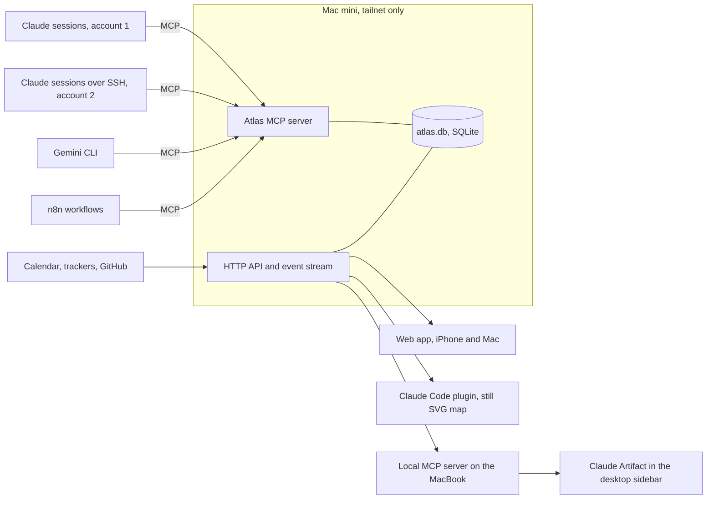

# Architecture

Atlas is a data model with several views. The data lives in one database on
a machine you own; every agent reads and writes it over MCP; the views draw
the same rows as a world.

## What Exists Today

| Package           | Status                                                     |
| ----------------- | ---------------------------------------------------------- |
| `@atlas/core`     | Built. Model, events, needs-you, boundary rules, tests     |
| `@atlas/fixtures` | Built. Invented dataset and a scripted day                 |
| `@atlas/worlds`   | Built. Astronomer and Mariner: layout, canvas, SVG, sounds |
| `@atlas/ui`       | Built. Shell, live map, panels, stories                    |
| `apps/storybook`  | Built. Story tests with axe; published to GitHub Pages     |
| `apps/server`     | Next                                                       |
| `apps/web`        | Next                                                       |
| `apps/artifact`   | Next                                                       |
| `apps/plugin`     | Later                                                      |

## The Data Model

Every record carries a **classification** (public, internal,
client-confidential, restricted) and a **boundary** (where it may live).
One client is marked **home**: your own business, drawn at the centre of
every world.

| Record       | Holds                                                                      |
| ------------ | -------------------------------------------------------------------------- |
| Client       | Name, whether it is home                                                   |
| Account      | A login an agent runs under, and its runtime (Claude, Gemini, n8n, script) |
| Agent group  | A group of agents serving one client                                       |
| Agent        | Account, host, how it can be reached, status, what it works on, a note     |
| Requirement  | What a client needs to be true                                             |
| Backlog item | Work, optionally serving a requirement, with state and priority            |
| Question     | What blocks a requirement or item, and who must answer                     |
| Decision     | What was decided, what it settles, the question it came from               |

Everything that changes the picture is an **event**: a message between
agents, an event from an outside system, a status change, a question
answered. The same event drives the database write, the animation, the log
line and the sound.

## Boundaries

What decides a boundary is **which model sees the data**, not where the file
sits. An email read by an agent signed in to your own Claude account has
left the client's boundary even if no file moved.

- An agent that reads client content runs inside the client's boundary,
  under the AI the client has approved.
- Records cross a boundary only as a **card**: id, kind, client, a title
  written for the destination, state, classification, and an opaque
  reference back. `exportCard` in `@atlas/core` enforces the shape and
  rejects a title that still holds an email address, a phone number, a long
  identifier or a URL with a query string.
- A destination that may not hold a record's classification gets only a
  "withheld" marker, so a restricted record shows as a count, never a title.

## The Server (Next)

- **Database:** SQLite in WAL mode with Drizzle for schema and migrations.
  Only the server process opens the file; agents go through MCP.
- **MCP tools:** `report_status`, `claim_item`, `ask_question`,
  `record_decision`, `link`, `list_my_work`, `list_open_questions`. Each
  agent gets its own token, scoped to the clients it may see.
- **Network:** Tailscale Serve on the tailnet only, with Funnel off. People
  are identified by Tailscale's identity headers; agents by their tokens.
- **Secrets:** the macOS Keychain. Never in the repository, never in the
  database.
- **Host:** a Mac mini with sleep off, restart after power failure, services
  under launchd, and FileVault on.

### Backups

| Layer      | How                                                                                       |
| ---------- | ----------------------------------------------------------------------------------------- |
| Continuous | Litestream streams every change to an encrypted off-site bucket                           |
| Nightly    | `VACUUM INTO` a snapshot on a local disk and in Time Machine, 30 days                     |
| Weekly     | An automated restore: integrity check, row counts, and a "Backup verified" event in Atlas |

A backup that has never been restored does not count.

## Where Each View Runs

| Where                  | Built from                        | Reaches the data through                                         |
| ---------------------- | --------------------------------- | ---------------------------------------------------------------- |
| iPhone and Mac browser | `apps/web`, a PWA                 | The API over the tailnet                                         |
| Claude desktop sidebar | `apps/artifact`, a one-file build | A local MCP server on the MacBook, then the API over the tailnet |
| Claude Code plugin     | `apps/plugin`                     | The API; shows the still SVG map and the needs-you list          |

**Can the Claude Artifact talk to the database?** On the Mac, yes: the
desktop app lets an artifact call a local MCP server, which forwards to the
API. In the iPhone Claude app, no: local MCP servers are not available
there, and Claude's own servers cannot reach a tailnet. The phone uses the
web app over Tailscale instead.

A Claude Code plugin pane can only draw Claude's own elements (boxes, text,
buttons, SVG). It cannot run the animated canvas, which is why
`@atlas/worlds` also renders a still SVG map.
