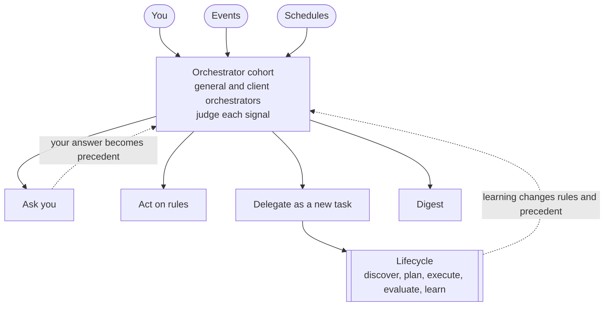
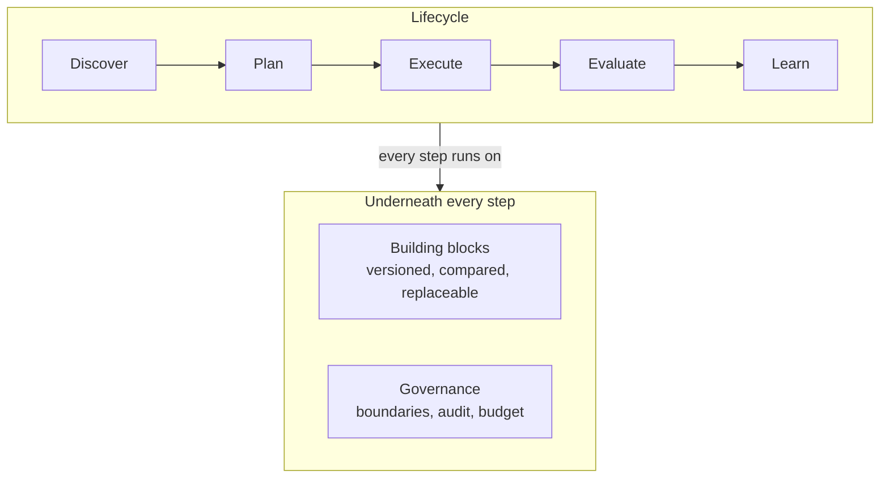

# The Standard Workflow

This folder describes how Atlas handles work from the moment something
happens to the moment Atlas has learned from the result. It is written for
you, the owner who runs Atlas, and for anyone who builds a part of it.

Most of the workflow is a design. Today Atlas draws the work and records
events; it does not yet judge or start work on its own. Each page marks
what exists and what is the target.

## The Workflow on One Page

1. **Signals** arrive. A signal is anything that may need attention: a
   message from you, an event from a system such as GitHub or a calendar,
   or a schedule such as a deadline.
2. **An orchestrator judges each signal.** An orchestrator is an agent that
   decides what happens to a signal. Atlas has a group of them, called the
   **cohort**. Some are general and talk to you. Others each serve one
   client and keep to that client's rules and boundary.
3. **Each judgement has one of four outcomes.** The orchestrator asks you,
   acts on a rule, delegates the work as a new tracked task, or puts the
   signal in a digest for you to read later. It records which outcome it
   chose and why.
4. **Delegated work follows a lifecycle**, which works like a scientific
   experiment. Discover turns an idea into a thesis with a prediction. Plan
   designs the test. Execute builds the change test first. Evaluate
   measures the result against the prediction. Learn changes the rules.
5. **Learning goes back to the cohort.** The next signal is judged with
   better rules, better precedent and better confidence levels.
6. **Building blocks do every step.** Each step is a slot that a
   replaceable block fills, such as a planning skill or a review agent. Two
   blocks can compete for one slot, and the better one stays.
7. **Governance applies to everything.** Client boundaries decide which
   model may see what, every decision is in an audit trail, and every
   orchestrator has a budget.

## The Capability Map

The map has two parts. The first shows how a signal becomes an outcome.

The second shows the lifecycle, and what every step stands on.

## What Exists Today

| Part                                                          | State       |
| ------------------------------------------------------------- | ----------- |
| Data model: questions, decisions, needs-you, boundary rules   | Built       |
| Worlds that draw the work                                     | Built       |
| Server, with the reader for GitHub events from gh-events      | Built       |
| Collector that reports what each Claude Code session is doing | Built       |
| Sidebar for the desktop, the phone and VS Code                | Built       |
| Plugin hooks that report subagents and permission prompts     | Built       |
| Dispatcher that hands GitHub signals to an orchestrator       | In progress |
| Orchestrator cohort and triage                                | Target      |
| Digest                                                        | Target      |
| Lifecycle records: thesis, experiment, measurement            | Target      |
| Registry of building blocks and their comparison              | Target      |

Delegated work is already tracked in the task database, which Atlas reads.
The tasks themselves live outside this repository.

## Reading Path

Each page goes one level deeper than the one before it.

| Level | Page                                          | Read it to learn                                            |
| ----- | --------------------------------------------- | ----------------------------------------------------------- |
| 1     | This page                                     | What the workflow is                                        |
| 2     | [Orchestration](orchestration.md)             | Who judges a signal, how, and what the four outcomes do     |
| 2     | [Event Sources](events.md)                    | Where signals come from and what each one does by default   |
| 2     | [Capabilities](capabilities.md)               | Every capability by layer, with its inputs and outputs      |
| 2     | [Building Blocks](building-blocks.md)         | Slots, contracts, the registry and the first slots          |
| 2     | [Core Model](core-model.md)                   | The records behind every capability, as a diagram           |
| 3     | [The Scientific Method](scientific-method.md) | How a prediction is made, tested, measured and learned from |
| Setup | [Claude Accounts](claude-accounts.md)         | Register each Claude subscription in its own folder         |

The pages share one invented example. You run your own business, called
Home. Your general orchestrator is called Compass. Two invented clients
each have a client orchestrator: the Northwind lead for Northwind Labs, and
the Kestrel lead for Kestrel Bank, which has a stricter boundary. Five
tasks, T1 to T5, move through the workflow, and one lesson, L1, changes a
confidence level. [Orchestration](orchestration.md) introduces them.

## Related

- [Architecture](../architecture.md) describes the parts that are built.
- [Event Triage and Decision Engine](../event-triage.md) is an earlier
  draft of how triage could work in tiers, from fixed code up to a large
  model.
