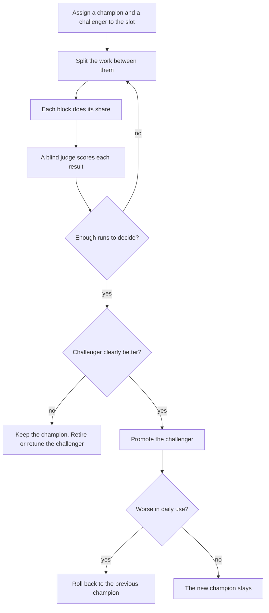

# Building Blocks

This page describes how each step of the workflow is done by a block that
can be replaced. Read [The Standard Workflow](README.md) first.

**State:** target. No registry, slot or comparison exists in Atlas yet.
Skills, agents and hooks are already in use, but nothing records which
slot each one fills or how well it does.

## Slots and Blocks

A **slot** is one named place in the workflow where work is done, such as
"plan writer" or "code review". A **building block** is what fills it. A
block can be a skill, an agent, a model, a hook or a tool.

Each slot has a **contract** with three parts:

1. the inputs the block receives;
2. the outputs it must return;
3. the success measure that scores it.

Because the contract is fixed, any block that keeps it can fill the slot.
Two blocks can then run side by side, and the better one can replace the
other.

## Champion and Challenger

A slot has one **champion**, the block that does the work today. It may
also have a **challenger**, a block under test. Work is split between them,
a judge scores both, and the challenger replaces the champion only when the
evidence is strong enough.

"Enough runs" and "clearly better" have exact meanings.
[The Scientific Method](scientific-method.md) explains them with numbers.

## The Registry

The registry lists every block with:

- the slot it fills;
- its version;
- its kind: skill, agent, model, hook or tool;
- its owner;
- its status: champion, challenger or retired.

Each block also has its measurements, so the registry can show a slot
matrix: phases as columns, slots as rows, and in each cell the champion,
any challenger and their scores.

## Metrics

| Metric        | What it measures                                                  |
| ------------- | ----------------------------------------------------------------- |
| Quality       | The slot's success measure, such as bugs caught or estimate error |
| Cost          | Model and tool spend for each run                                 |
| Time          | How long each run takes                                           |
| Override rate | How often you reject or change the block's result                 |
| Calibration   | How close the block's predictions are to what happened            |

## The First Slots

Each slot below is one place a block plugs in. The candidates are
public projects on GitHub that could compete for it. They were judged
from the opening of their README only, and none has been tested in Atlas.

| Slot                 | Phase           | Candidate blocks                                                         |
| -------------------- | --------------- | ------------------------------------------------------------------------ |
| Triage policy        | Cohort          | None found. Atlas's own                                                  |
| Precedent recall     | Cohort          | `samdotmak/jev-recall`, `deeplethe/utopia`                               |
| Unknowns finder      | Discover        | `Neeeophytee/finding-unknowns-skills`                                    |
| Assumption challenge | Discover        | `mattnowdev/thinking-partner`                                            |
| Research             | Discover        | `kunal12203/webify-mcp`, `DragonShadows1978/AI-AtlasForge`               |
| Thesis writer        | Discover        | None found. Atlas's own                                                  |
| Plan writer          | Plan            | `obra/superpowers` planning skill, `garrytan/gstack` engineering manager |
| TDD discipline       | Execute         | `nizos/probity`, `obra/superpowers` TDD skill                            |
| Workspace isolation  | Execute         | `rohansx/workz`                                                          |
| Code review          | Evaluate        | `garrytan/gstack` reviewer and security, `vertti/se-cove-claude-plugin`  |
| Code quality gate    | Evaluate        | `yfedoseev/fossil-mcp`                                                   |
| Calibration          | Learn           | `EmpiricaAI/empirica`                                                    |
| Block evaluation     | Building blocks | `kayba-ai/autoharness`, `TiesPetersen/SkillBenchmark`                    |

TDD means test-driven development: write a test that fails, then the code
that makes it pass.

## The Example Slot Matrix

In the invented example, six slots run a challenger. All the numbers are
invented.

| Slot             | Champion                                       | Challenger                              |
| ---------------- | ---------------------------------------------- | --------------------------------------- |
| Triage policy    | Atlas triage v2: 81% agreed with you, 140 runs | Atlas triage v3: 86%, 22 runs           |
| Precedent recall | jev-recall: 0.74 precision, 140 runs           | utopia: 0.79, 15 runs                   |
| Plan writer      | superpowers plan: 38% estimate error, 31 runs  | gstack engineering manager: 29%, 8 runs |
| TDD discipline   | probity: 92% red before green, 18 runs         | superpowers TDD: 89%, 6 runs            |
| Code review      | gstack review: 71% of bugs caught, 25 runs     | se-cove: 64%, 10 runs                   |
| Block evaluation | autoharness: no score yet, 4 runs              | SkillBenchmark: no score yet, 2 runs    |

The challenger leads in three slots, and in each of them it has far fewer
runs than the champion. Task T2 runs the TDD challenger. A lead on a small
sample is not yet evidence.
[The Scientific Method](scientific-method.md) shows why.

## Open Questions

1. How is work split between the two blocks: alternate work items, run
   both on the same item, or replay past items?
2. Who may promote a challenger: you only, or an orchestrator under a rule?
