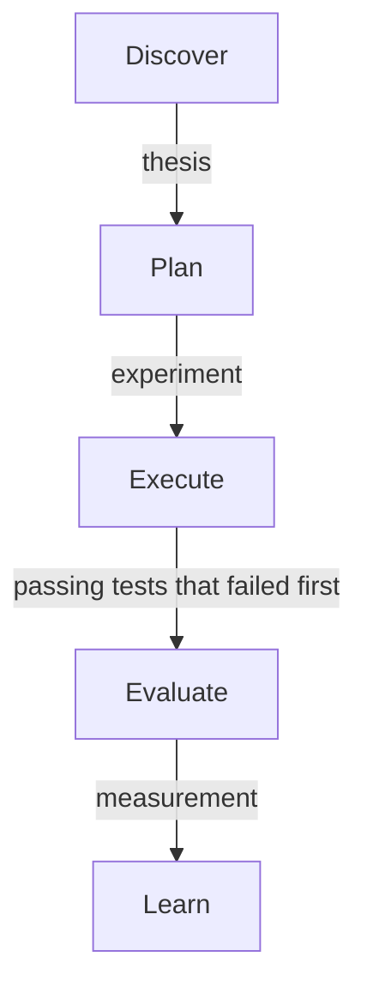

# Capabilities

This page lists every capability the workflow needs, layer by layer, with
what goes in and what comes out. The layers follow the map in
[The Standard Workflow](README.md). The scope is the software development
lifecycle only.

**State:** the data model, the needs-you list, the worlds, the GitHub
reader, the collector and the plugin hooks exist. The column "Today" says
which capability one of them covers. Everything else is the target.

## Signals

| Capability    | In                                                                                | Out                           | Today                          |
| ------------- | --------------------------------------------------------------------------------- | ----------------------------- | ------------------------------ |
| Intake        | A message from you, an event, a schedule or deadline, an escalation from an agent | One signal record             | GitHub events, in part         |
| Deduplication | A new signal, the open signals                                                    | A merged signal or a new one  | Target                         |
| Routing       | A signal, the orchestrator charters, the client boundaries                        | The orchestrator that owns it | Target, dispatcher in progress |

## Orchestrator Cohort

| Capability       | In                                           | Out                                                                  | Today  |
| ---------------- | -------------------------------------------- | -------------------------------------------------------------------- | ------ |
| Charter          | Your settings for each orchestrator          | Its scope, client, rules, allowed actions, budget, confidence floor  | Target |
| Triage           | A signal, the charter, precedent             | A decision: act, ask, delegate or digest, with confidence and reason | Target |
| Precedent memory | Past decisions and their outcomes            | The precedents that apply to a new signal                            | Target |
| Handoff          | A decision outside this orchestrator's scope | The signal, routed to the orchestrator that owns it                  | Target |

## Outcomes

| Capability   | In                                     | Out                                                                                               | Today                                  |
| ------------ | -------------------------------------- | ------------------------------------------------------------------------------------------------- | -------------------------------------- |
| Ask you      | A decision to ask                      | A question with options, evidence, a recommendation and a deadline. The answer becomes precedent  | Questions and the needs-you list exist |
| Act on rules | A decision to act, a rule or precedent | The action, logged against the decision                                                           | Target                                 |
| Delegate     | A decision to delegate                 | A delegation: a new task, a contract, a worker, an isolated workspace, progress, accept or reject | Tasks exist in the task database       |
| Digest       | A decision to digest                   | The item in the next daily or weekly digest                                                       | Target                                 |

## Lifecycle

Each phase must produce its output before the next phase starts.
[The Scientific Method](scientific-method.md) explains each output in
depth.

| Phase    | Capabilities                                                                                                    | Must produce before the next phase                                                        |
| -------- | --------------------------------------------------------------------------------------------------------------- | ----------------------------------------------------------------------------------------- |
| Discover | Idea inbox, research, finding unknowns, challenging assumptions, writing the thesis                             | A thesis: the problem, the prediction, the metric and the kill criteria. Go, park or kill |
| Plan     | Experiment design, acceptance criteria as tests that can fail, breakdown, risk, estimate                        | An experiment: the test plan as the Definition of Done, and the estimate as a prediction  |
| Execute  | Test-driven development with red, green and refactor enforced, guardrails, checkpoints, isolated workspaces     | Passing tests that failed first, and the change                                           |
| Evaluate | Check against the Definition of Done, code and security review, measure against the prediction, your acceptance | A measurement, and accept or reject                                                       |
| Learn    | Calibration, updating rules and precedent, promoting or retiring building blocks, a retrospective               | Changed rules, precedent and slot assignments                                             |

The Definition of Done is the list of checks that decide whether the work
is finished. Here it is written as tests, so it can fail.

## Building Blocks

[Building Blocks](building-blocks.md) describes these in depth.

| Capability             | What it does                                                                 | Today  |
| ---------------------- | ---------------------------------------------------------------------------- | ------ |
| Registry               | Lists each block, the slot it fills, its version and its owner               | Target |
| Slot contract          | Fixes a slot's inputs, outputs and success measure, so blocks can be swapped | Target |
| Assignment             | Chooses the champion and any challenger for a slot, and how work is split    | Target |
| Evaluation harness     | Runs benchmarks and a blind judge, and reports confidence intervals          | Target |
| Metrics                | Quality, cost, time, how often you override, calibration                     | Target |
| Promotion and rollback | Makes a challenger the champion, or goes back to the previous champion       | Target |

## Governance

| Capability  | What it does                                                    | Today                                                 |
| ----------- | --------------------------------------------------------------- | ----------------------------------------------------- |
| Boundaries  | Client data classification, and which model may see what        | Classification, boundaries and the card export exist  |
| Permissions | What each orchestrator and block may do without asking          | Target                                                |
| Audit trail | Every decision, delegation and action, traced to its signal     | The event log exists. The links to signals are target |
| Budget      | Cost limits per orchestrator, per delegation and per experiment | Target                                                |

A card is the short form of a record that may cross a boundary: an id, a
kind, a client, a title written for the destination and a reference back.
See [Architecture](../architecture.md).

## Views

Atlas already draws the work as a world, with a needs-you list. These views
are the target for the workflow.

| View                  | Shows                                                                   |
| --------------------- | ----------------------------------------------------------------------- |
| Cohort map            | Each orchestrator, its scope and what it is handling                    |
| Work item flow        | Where each item is in the lifecycle, and what it produced at each phase |
| Needs-you queue       | Open questions to you, with options and deadlines                       |
| Decision log          | Decisions, their reasons and their outcomes                             |
| Experiment scoreboard | Champion against challenger for each slot, with the metrics             |
| Calibration           | Predicted against actual, for each orchestrator and each block          |

The chosen layout puts four of these on one page. A board shows every item
by phase. A tree of orchestrators on the left filters the board. A ring at
the top shows the lifecycle loop. A detail panel tells the full story of
the selected item. A second tab holds the slot matrix of building blocks.
