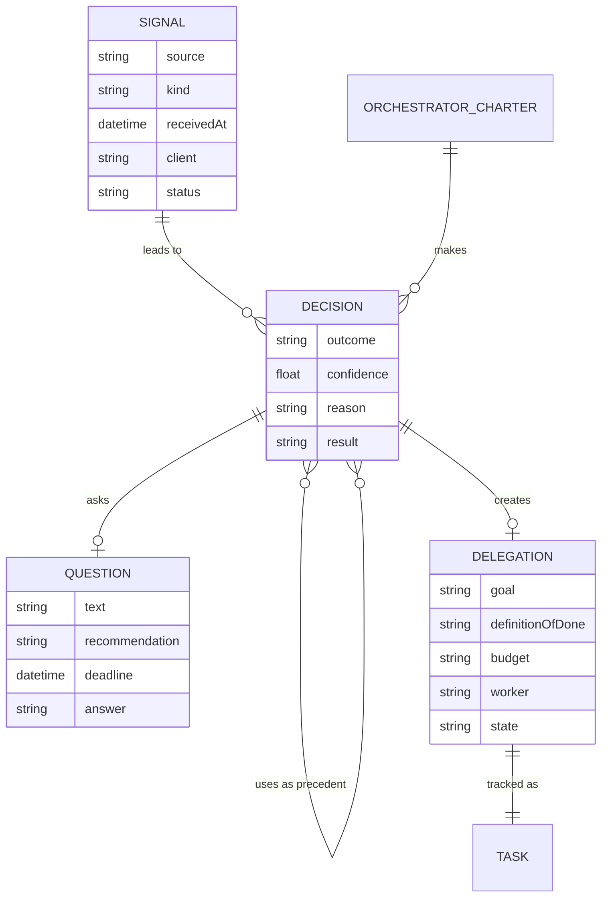
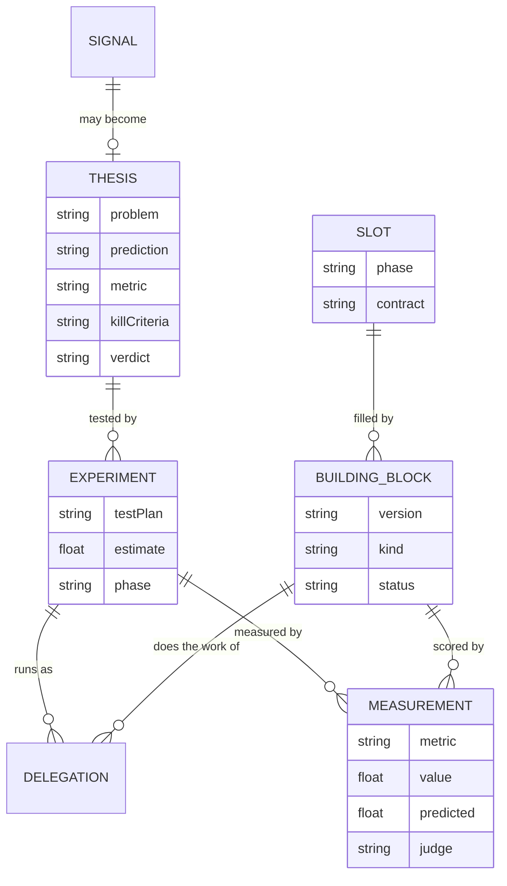

# Core Model

This page lists the records that every capability and view depends on, and
how they link. Read [Capabilities](capabilities.md) first. The names are
working names.

**State:** mostly target. Atlas already has questions, decisions and tasks.
Its decision records what was decided, the item or requirement it settles
and the question it came from. The target decision also holds the outcome, the confidence and the precedents
used. The other records do not exist yet.

## The Records

| Record               | Holds                                                                                                | Links to                                    |
| -------------------- | ---------------------------------------------------------------------------------------------------- | ------------------------------------------- |
| Signal               | Source, kind, received at, client, a reference to the payload, status                                | The decisions it led to                     |
| Orchestrator charter | Name, general or client, client, scope, rules, allowed actions, budget, confidence floor, version    | Its decisions                               |
| Decision             | Act, ask, delegate or digest; confidence; reason; precedents used; the outcome, once known           | Signal, charter, question or delegation     |
| Question             | Text, options, recommendation, evidence, deadline, answer, answered at                               | Decision                                    |
| Delegation           | Contract (goal, Definition of Done, budget, deadline, shape of the return), worker, workspace, state | Decision, task, the block that did the work |
| Task                 | The record in the task database                                                                      | Delegation, details page, pull requests     |
| Thesis               | Problem, prediction, metric, kill criteria; go, park or kill                                         | Signal, experiments                         |
| Experiment           | Test plan, the estimate as a prediction, phase                                                       | Thesis, delegations, measurements           |
| Building block       | Slot, version, kind (skill, agent, model, hook, tool), owner, status (champion, challenger, retired) | Slot, measurements                          |
| Slot                 | Phase, contract (inputs, outputs, success measure)                                                   | Building blocks                             |
| Measurement          | Metric, value, predicted value, when, which judge                                                    | Experiment or building block                |

## From Signal to Task

A signal can lead to more than one decision. In the example, signal S2
led to decision D2 (run the test again) and then to D3 (delegate a fix).
A decision can use earlier decisions as precedent.

## Experiments and Building Blocks

The experiment side holds the prediction and the measurement. A
measurement belongs either to an experiment, when it measures a piece of
work, or to a building block, when it scores the block.

## Why the Predicted Value Sits in the Measurement

A measurement stores the predicted value beside the actual one. Calibration
needs both, and the prediction must be written before the result is known.
[The Scientific Method](scientific-method.md) explains why that order
matters.
