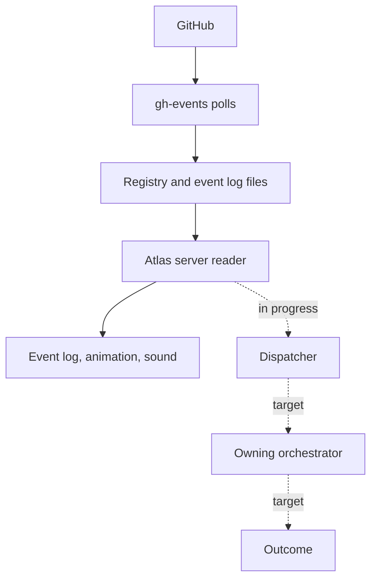

# Event Sources

This page lists where signals come from and what each one triggers by
default. It is the Signals layer of [The Standard Workflow](README.md). The
default is what a rule does before precedent or judgement change it. See
[Orchestration](orchestration.md) for how triage works.

**State:** Atlas reads GitHub events today through gh-events, and records
the events that match a task. The other sources and every default action
in the tables below are the target.

## Every Event Is a Signal and Gets an Outcome

1. **Signal.** Every source writes one normalised record: source, kind,
   subject, client, time and a link. The subject is what the event is
   about, such as a pull request, a ticket, a mail thread or an invite. No
   text an author wrote goes in beyond a title.
2. **Correlate.** Signals about the same subject join one item.
3. **Triage.** The orchestrator that owns the client tries rules, then
   precedent, then judgement.
4. **Outcome.** Auto-act, delegate, digest or ask you.
5. **Show.** Every signal and every outcome appears in Atlas as an event,
   including what was done automatically.

## GitHub

Today, Atlas never calls GitHub. A separate process, gh-events, polls
GitHub and writes a registry file and an event log, and the Atlas server
reads them. The server records an event only when it matches a task, and
nothing acts on it.

The target closes three gaps:

1. Atlas records **every** GitHub event as a signal, matched to a task or
   not.
2. gh-events adds events for "your review was requested" and "changes
   requested", and reads Dependabot, code scanning and secret scanning
   alerts.
3. A dispatcher hands each new signal to its owning orchestrator. A pull
   request for the dispatcher is in progress.

| Event                                              | Default outcome                                                                    | Today                                |
| -------------------------------------------------- | ---------------------------------------------------------------------------------- | ------------------------------------ |
| Checks failed on your pull request                 | Delegate a fix to the session that opened it, or to a new agent                    | Recorded only when it matches a task |
| Approved, checks green                             | Auto-act: merge by the repository's merge policy                                   | Recorded only when it matches a task |
| Merge conflict                                     | Delegate a rebase                                                                  | Recorded only when it matches a task |
| Changes requested, or new review comments          | Delegate: address the comments                                                     | Not read                             |
| Your review requested                              | Delegate a first review to an agent, then ask you with its summary                 | In the registry, no event            |
| Dependabot pull request                            | Auto-act: merge a patch or minor update with green checks. Delegate a major update | Seen only as a pull request          |
| Dependabot, code scanning or secret scanning alert | By severity. Critical or high: delegate and ask. Medium: delegate. Low: digest     | Not read                             |
| Workflow failed on `main`                          | Delegate. Ask you if a release is blocked                                          | Not read                             |
| Release pull request ready                         | Digest, or auto-act on a release schedule                                          | Seen only as a pull request          |
| Issue assigned to you, or a mention                | Route to the client orchestrator                                                   | In the registry, no event            |

A repository's merge policy is one of squash, merge commit or rebase. A
regulated repository may need a merge commit, so the history shows each
change as it was reviewed.

## Trackers

Each client may use a different tracker, such as Jira, Monday or GitHub
Issues. Every tracker gives the same kinds of signal.

| Event                                 | Default outcome                                   |
| ------------------------------------- | ------------------------------------------------- |
| Item assigned to you                  | The client orchestrator updates the task          |
| Status changed on your item           | The client orchestrator updates the task          |
| A comment or update that mentions you | Ask you when it needs an answer, otherwise digest |
| Sprint start or end                   | Digest                                            |

## Calendar

| Event                     | Default outcome                                                                 |
| ------------------------- | ------------------------------------------------------------------------------- |
| New invite                | Accept or decline by rules: conflicts, client, working hours. Otherwise ask you |
| Time change, cancellation | Update the plan for the day, then digest                                        |
| Meeting starting soon     | Delegate a short preparation brief                                              |
| Meeting ended             | Delegate notes from the transcript                                              |

## Mail

Mail is classified first, then routed.

| Kind of mail     | Default outcome                  |
| ---------------- | -------------------------------- |
| Receipt          | Delegate to the expenses skill   |
| Supplier invoice | Delegate to the bills skill      |
| Junk             | Auto-act: move it to junk        |
| Client request   | Route to the client orchestrator |
| Anything else    | Digest                           |

## Chat

| Event                           | Default outcome                      |
| ------------------------------- | ------------------------------------ |
| A direct message or a mention   | Ask you when it is a direct question |
| A message in a client's channel | Route to the client orchestrator     |

## Atlas Itself and Your Machines

Atlas is also a source. These signals come from the collector, the plugin
hooks and the server.

| Source            | Event                                                | Default outcome                                                                                             |
| ----------------- | ---------------------------------------------------- | ----------------------------------------------------------------------------------------------------------- |
| Sessions          | Waiting for approval, stuck, idle with an open task  | Ask you, or nudge the session                                                                               |
| Release status    | An environment drifted from its branch               | Delegate, or digest when the drift is expected                                                              |
| Budgets and usage | An orchestrator near its budget, a usage limit near  | Digest. Ask you when a limit would stop work                                                                |
| Usage limits      | A Claude Code session hit a subscription usage limit | Show the agent blocked until the reset. Restart it under another account when the account-switch rule is on |
| Host statistics   | Disk, memory or CPU over a threshold                 | Delegate a clean-up. Ask you when it repeats                                                                |
| Schedules         | Timesheet deadlines, month end, routines             | Auto-act or delegate by rule                                                                                |

### Usage-Limit Signals

The server reads each live Claude Code session's transcript. When a
session hits a subscription usage limit, its agent shows `blocked` with a
fixed note, such as "Weekly usage limit reached, resets 25 Oct 18:00", and
Atlas records one `signal` event:

| Field       | Value                                                         |
| ----------- | ------------------------------------------------------------- |
| `source`    | `claude`                                                      |
| `kind`      | `usage-limit`                                                 |
| `event`     | `limit_reached`                                               |
| `agentId`   | The agent the session belongs to                              |
| `account`   | The account name from the accounts file, or null              |
| `limitKind` | `session` (the five-hour limit), `weekly`, or `other`         |
| `resetsAt`  | When the limit resets, or null when Claude Code gave no time  |
| `text`      | The note the agent shows. Never the message Claude Code wrote |

The account-switch rule acts on it, and is off unless switched on. Each
decision is an `account-switch` event. See
[Usage Limits](../architecture.md#usage-limits). To register the accounts
and see each one's limit, use [Claude Accounts](claude-accounts.md).

## Client Boundaries Apply to Sources

A source that holds client content, such as a client's tracker or chat,
may need to stay inside that client's boundary. Its orchestrator then runs
under the client's approved AI, and only titles leave. Which sources this
applies to is decided per client. It is an open question for each new
client.
