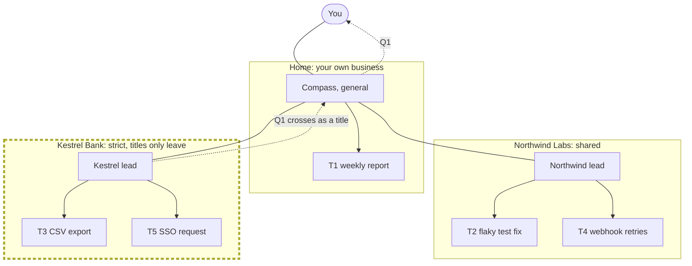
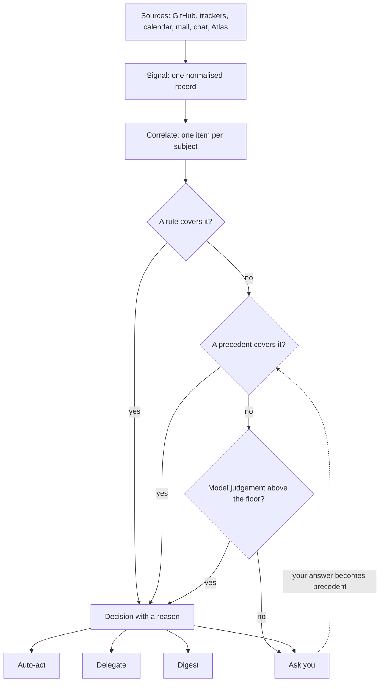

# Orchestration

This page describes who judges a signal, how the judgement is made, and
what each of the four outcomes does. Read [The Standard Workflow](README.md)
first.

**State:** target. Atlas records events and shows questions that wait on
you, but no orchestrator judges a signal yet. A dispatcher that hands
GitHub signals to an orchestrator is in progress.

## The Cohort

An **orchestrator** is an agent that owns a set of signals and decides what
happens to each one. Atlas does not use one orchestrator for everything.
It uses a **cohort**, a group of orchestrators with separate scopes.

- A **general orchestrator** talks to you, works across clients and runs
  routines such as a weekly review.
- A **client orchestrator** serves one client. It carries that client's
  rules, and it keeps to that client's boundary.

Each orchestrator has a **charter**: its scope, its client, its rules, the
actions it may take without asking, its budget and its **confidence
floor**. The confidence floor is the lowest confidence at which it may act
alone. Below the floor, it asks you or delegates something that can be
undone.

### The Example Cohort

| Orchestrator   | Kind    | Client         | Scope                                 | Budget    | Confidence floor |
| -------------- | ------- | -------------- | ------------------------------------- | --------- | ---------------- |
| Compass        | General | Home           | Talks to you, cross-client, routines  | £20 a day | 0.6              |
| Northwind lead | Client  | Northwind Labs | Northwind repositories, CI, tickets   | £15 a day | 0.7              |
| Kestrel lead   | Client  | Kestrel Bank   | Kestrel delivery, inside its boundary | £15 a day | 0.8              |

CI means continuous integration: the checks that run on every change. The
Kestrel lead has the highest floor because Kestrel Bank's work is
client-confidential. It must be more sure before it acts alone.

### The Cohort as a Tree

You are at the root. Each client orchestrator sits inside its client's
boundary, and delegated tasks are the leaves. Kestrel Bank's boundary is
stricter. An agent that reads Kestrel content runs under the AI that
Kestrel Bank has approved, and records leave the boundary as titles only.

The question Q1 takes two steps to reach you. It leaves Kestrel's boundary
as a title only, and Compass puts it on your list. SSO means single
sign-on.

## Triage

Triage is how an orchestrator judges a signal. It tries the cheapest method
first and only moves on when that method does not settle the signal.

1. **Rules.** A fixed rule decides. For example, "a Dependabot patch with
   green checks, in a repository without extra regulation: merge".
2. **Precedent.** You decided the same kind of item before. The
   orchestrator does what you decided then.
3. **Judgement.** A model call decides, and gives a confidence level. The
   orchestrator acts only when the confidence is above its floor.

Before triage, Atlas **correlates** signals. Signals about the same subject
join one item. A failing check, a review comment and a security alert on
the same pull request are one item, not three.

### The Triage Funnel

Every decision records the outcome, the confidence, the reason and the
precedents used. Later, it also records how the decision turned out. That
record is what [The Scientific Method](scientific-method.md) learns from.

The earlier draft [Event Triage and Decision Engine](../event-triage.md)
splits the same funnel into tiers by cost and speed. The rules step there
is fixed code, and the judgement step is split between a small, fast
decision model and a large model.

## The Four Outcomes

| Outcome  | When                                                                 | What happens                                                         |
| -------- | -------------------------------------------------------------------- | -------------------------------------------------------------------- |
| Auto-act | A rule or a strong precedent covers it, and the action can be undone | The orchestrator acts and logs it. No task is created                |
| Delegate | Work is needed                                                       | A new tracked task, given to an agent                                |
| Digest   | Worth knowing, not worth interrupting you                            | Collected into a daily or weekly digest                              |
| Ask you  | Judgement, risk, money, the client relationship, or low confidence   | A question on your needs-you list, with options and a recommendation |

A question to you always carries options, the evidence, a recommended
option and a deadline. When you answer, the answer becomes precedent, so
the next item of the same kind may not need you.

The digest keeps routine items off your needs-you list without losing
them. Every signal and every outcome also shows in Atlas as an event,
including what was done automatically.

### The Example Decisions

| Signal                                            | Orchestrator   | Outcome  | Confidence | Reason                                                             |
| ------------------------------------------------- | -------------- | -------- | ---------- | ------------------------------------------------------------------ |
| S1: your idea, a weekly client report by an agent | Compass        | Delegate | 0.7        | A new idea needs a thesis before any build. Task T1                |
| S2: CI failed on the Northwind API at 02:14       | Northwind lead | Act      | 0.9        | Rule R7: a known flaky test, run it once more                      |
| S2, after the rerun failed too                    | Northwind lead | Delegate | 0.6        | A fix is needed. Below the floor, but a fix can be undone. Task T2 |
| S3: Kestrel email asks to add SSO to phase 1      | Kestrel lead   | Ask you  | 0.4        | The change touches the contract, and there is no precedent         |
| S4: the weekly calibration routine                | Compass        | Act      | 0.95       | A routine. It recorded lesson L1                                   |

## Delegation Is a Tracked Task

Every delegation creates a task in the task database, so you can trace the
work from the decision to the result. A delegation is more than a task. It
also carries a **contract**:

- the goal;
- the Definition of Done, written as tests that can fail;
- the budget and the deadline;
- the shape of what the worker must return.

The delegation also names the worker, gives it an isolated workspace such
as its own git worktree, collects its progress reports, and ends with an
accept or a reject of the result.

A delegation enters the lifecycle at the phase it needs. An idea starts at
Discover. A fix skips Discover and starts at Plan, because the problem is
already known. T2 took that route.

### Handoff

When a signal is outside an orchestrator's scope, the orchestrator hands it
to the one that owns it. Compass hands a Kestrel email to the Kestrel lead.
A handoff is recorded like any other decision.

## Open Questions

1. Does a client orchestrator run inside the client's boundary, under the
   client's approved AI, or does it only route to agents that do?
2. Which confidence or risk level makes an orchestrator ask instead of act,
   and should it differ per client?
3. Which actions may run without asking? A merge can be undone only by a
   revert, so it may need a rule per repository.
4. How often does the digest go out, and where?
5. Does the agent that opened a pull request own the events that follow on
   it?
