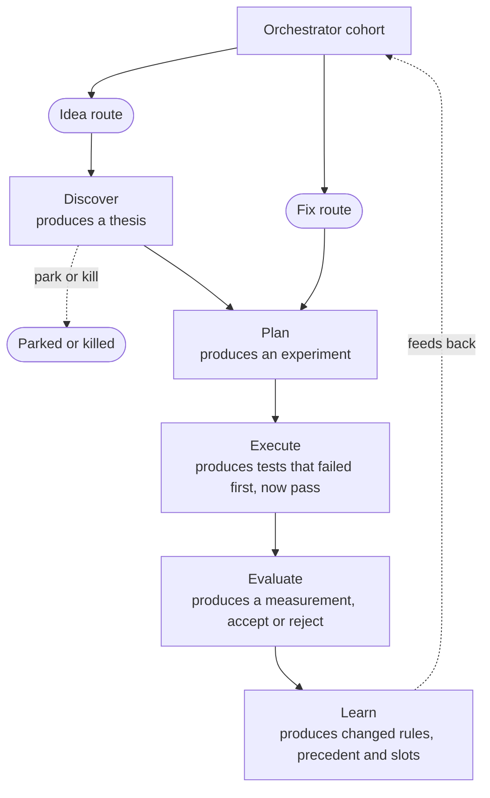
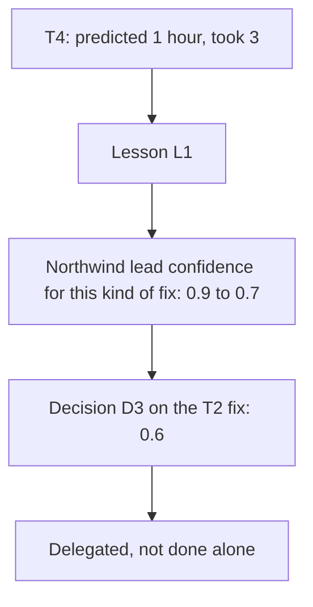
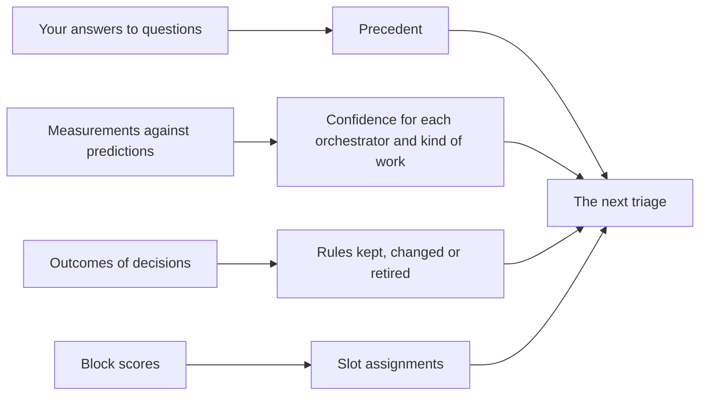

# The Scientific Method

This page explains why the lifecycle works like an experiment, and how
Atlas learns from each piece of work. It is the deepest page in this
folder. Read [The Standard Workflow](README.md) and
[Orchestration](orchestration.md) first.

Each section goes one step deeper than the one before. The first sections
are about one piece of work. The later sections are about how Atlas
compares its own tools and changes its own rules.

**State:** target. Atlas tracks tasks today, but it records no thesis,
prediction, measurement or calibration yet. The numbers in the examples are
invented.

## The Loop

Every delegated piece of work is an experiment. It starts with a
prediction, tests it, measures the result and changes what Atlas believes.
Each phase must produce its output before the next phase starts.

A fix skips Discover, because the problem is already known. A rule action
and a question to you do not enter the loop at all.

## A Thesis and a Prediction That Can Fail

Discover turns an idea into a **thesis**. A thesis has four parts:

1. **The problem.** What is wrong or missing today.
2. **The prediction.** What will be different if the work succeeds.
3. **The metric.** The number that shows whether the prediction came
   true.
4. **The kill criteria.** The result that ends the work.

A prediction is useful only if it can turn out wrong. "The report will
help" cannot fail, so it teaches nothing. "Monday preparation drops from 60
to 15 minutes" can fail, and you will know when it does.

The kill criteria are written now, before any work starts. At that point
nobody has spent effort on the idea, so nobody wants to protect it.

### Example: T1, a Weekly Client Report

You give Compass an idea: a weekly client report written by an agent.
Compass delegates it to Discover as task T1.

| Part          | T1                                                               |
| ------------- | ---------------------------------------------------------------- |
| Problem       | Preparing for Monday takes an hour of your time                  |
| Prediction    | The report cuts Monday preparation from 60 to 15 minutes         |
| Metric        | Minutes of Monday preparation                                    |
| Kill criteria | Kill it if preparation still takes over 30 minutes after 3 weeks |

Discover ends with one of three verdicts. **Go** sends the thesis to Plan.
**Park** keeps it for later. **Kill** stops it and records why.

## The Plan as an Experiment Design

Plan turns the thesis into an **experiment**. An experiment has two parts.

- **The Definition of Done**, written as tests that can fail. The
  Definition of Done is the list of checks that decide whether the work is
  finished. Each check is something a machine or a person can run and see
  fail. "The code is clean" is not a check. "No function is longer than 40
  lines" is.
- **The estimate, written as a prediction.** An estimate of one hour is a
  claim about the future. It is recorded so it can be compared with what
  happened.

### Example: T2, a Flaky Payment Test

CI on the Northwind API failed at 02:14. CI means continuous integration,
the checks that run on every change. The Northwind lead ran the test once
more under rule R7, and it failed again. It delegated a fix as task T2,
which starts at Plan.

| Part               | T2                                                                    |
| ------------------ | --------------------------------------------------------------------- |
| Definition of Done | The payment test passes 50 runs in a row. The test has no sleep calls |
| Estimate           | 1 hour                                                                |

Both checks can fail. A test that passes 49 times and then fails has not
met the Definition of Done. A test that passes because it waits longer has
hidden the problem, so the second check forbids sleep calls.

## Test-Driven Development as Falsification in Small

Test-driven development (TDD) applies the same method to each small change.
A test is a small prediction: "this code does this". The cycle has three
steps.

1. **Red.** Write a test, run it, and watch it fail.
2. **Green.** Write the least code that makes it pass.
3. **Refactor.** Improve the code while the test stays green.

The red step matters most. A test that has never failed may be unable to
fail. It may test the wrong thing, or nothing at all. Seeing it fail first
proves it can detect the problem.

For T2, red means a test that runs the payment test 50 times and fails on
today's code. Green means a change that makes all 50 runs pass with no
sleep call. The TDD discipline slot in [Building Blocks](building-blocks.md)
measures how often a block really writes red before green.

## Measuring Against the Prediction

Evaluate compares the result with the prediction, using the metric chosen
in Discover or the estimate made in Plan. The question it answers is
whether the prediction came true.

Evaluate produces a **measurement**: the metric, the actual value, the
predicted value, when it was measured and which judge measured it. It then
accepts or rejects the work. You are the final acceptance gate where the
charter says so.

### Example: T3, a CSV Export

T3 added a CSV export for Kestrel Bank's statements. The prediction was 40%
fewer support tickets about exports. After one week, tickets are down 25%.

T3 is not a failure yet. The measurement window was set in the plan, and it
has not ended. Judging early is a form of bias, described under
[Guarding Against Bias](#guarding-against-bias). T3 stays in Evaluate,
watched, until the window ends.

## Calibration

Calibration asks whether an orchestrator's confidence matches what
happens. Treat a confidence of 0.9 as a claim that nine of ten such
decisions will turn out right. If only six of ten turn out right, the
orchestrator is overconfident. Its confidence for that kind of work should
fall, so it asks or delegates more often.

### Example: T4 and Lesson L1

T4 added retry logic for webhooks. The estimate was 1 hour. It took 3
hours. The weekly calibration routine recorded a lesson.

> L1: the webhook fix took 3 hours against a 1-hour prediction. The
> Northwind lead's confidence for flaky-test and retry fixes falls from 0.9
> to 0.7.

L1 was recorded on Sunday evening. On Monday at 02:14, the Northwind lead
judged the T2 fix with the lower confidence. Its decision D3 had a
confidence of 0.6, below its floor of 0.7, so it could not act alone. A
fix can be undone and goes through review, so it delegated the fix as T2
rather than asking you.

### The Brier Score in Plain Words

The Brier score measures how good a set of confidence levels was. For each
prediction:

1. take the confidence, as a number from 0 to 1;
2. subtract what happened: 1 if the prediction came true, 0 if not;
3. square the difference.

The score is the average over all predictions. Lower is better.

| Score | Means                                          |
| ----- | ---------------------------------------------- |
| 0     | Every prediction was right, at full confidence |
| 0.25  | What you get by always saying 0.5, a coin toss |
| 1     | Every prediction was wrong, at full confidence |

Take T4, and read the confidence as "the fix lands within the estimate".
At 0.9 it did not, so T4 scores (0.9 − 0)², which is 0.81. At 0.7 the same
miss scores 0.49. The score punishes a confident miss more than a careful
one, so an orchestrator cannot score well by always sounding sure. In the
example, the calibration block's score is 0.18 over 52 predictions, better
than a coin toss but far from perfect.

## Comparing Building Blocks

The same method applies to Atlas's own tools. Each slot has a champion, the
block in use, and may have a challenger, a block under test. See
[Building Blocks](building-blocks.md) for the slots and the flow from
assignment to promotion or rollback.

### How Work Is Split

| Split                 | How it works                                      | Strength                        | Weakness                                    |
| --------------------- | ------------------------------------------------- | ------------------------------- | ------------------------------------------- |
| Alternate work items  | Each new item goes to one block, chosen at random | Cheap. Real work                | Items differ, so it needs many items        |
| Both on the same item | Each block does the same item, a judge picks      | A fair comparison on every item | Twice the cost. Only one result can be used |
| Replay past items     | The challenger redoes items already finished      | Fast. The right answer is known | Past items may not look like future ones    |

Which split to use is an open question. It may differ per slot. For the
triage slot, replay is cheap, because your past answers are the right
answers. When both blocks face the same items, each item compares them
directly, so fewer items are needed.

The choice of block for each item must be random. If someone picks, the
easy items may go to one block, and that block will look better than it is.

### Why a Small Sample Misleads

In the example, task T2 runs the TDD challenger. The challenger has 89% red
before green over 6 runs, against the champion's 92% over 18. With 6 runs,
one more pass or fail moves the rate by about 17 points. The difference of
3 points tells you nothing yet.

### Confidence Intervals in Plain Words

A **confidence interval** is the range where the true rate probably lies,
given the runs so far. "95%" means that if you repeated the method many
times, the range would hold the true rate 95 times out of 100. More runs
give a narrower range.

Take the triage slot. The champion, triage v2, agreed with you in 113 of
140 decisions. The challenger, triage v3, agreed in 19 of 22.

| Block     | Agreed     | Rate | 95% interval |
| --------- | ---------- | ---- | ------------ |
| Triage v2 | 113 of 140 | 81%  | 73% to 86%   |
| Triage v3 | 19 of 22   | 86%  | 67% to 95%   |

The intervals are Wilson score intervals, a standard way to compute one for
a rate. They overlap almost entirely. Triage v3 may be better, the same or
worse. To tell 81% from 86% with 95% confidence, and an 80% chance of
seeing a real difference, each version needs about 860 decisions. Replay
of past decisions is the realistic way to get there.

### Promotion and Rollback

Decide the rule before the test starts. A rule that fits the method:

1. **Promote** when the interval for the difference between the two blocks
   lies above zero, or above the smallest gain worth the switch, and cost
   and time are not worse.
2. **Keep the champion** when the test reaches its planned number of runs
   without that result.
3. **Roll back** when the new champion does worse in daily use than the
   old one did. The registry keeps the previous version, so rollback is a
   change of assignment, not a rebuild.

Who may promote, you only or an orchestrator under a rule, is an open
question.

## Guarding Against Bias

The method only works if the result cannot bend the test. Each guard below
stops one way that a result can be bent.

| Guard                        | What it stops                                                  | How                                                                            |
| ---------------------------- | -------------------------------------------------------------- | ------------------------------------------------------------------------------ |
| Blind judging                | The judge prefers the block it expects to win                  | The judge sees the result, not which block made it                             |
| Pre-register the prediction  | A prediction written after the result, to fit it               | The prediction, metric and kill criteria are stored before Execute starts      |
| Do not move the goal         | The kill criteria are relaxed because the work is nearly there | A changed goal is a new thesis, with a new record and a new prediction         |
| Fix the number of runs first | Stopping a test the moment the challenger looks ahead          | The experiment states how many runs it needs, and the result is read only then |
| Random assignment            | Easy items go to one block                                     | The block for each item is chosen at random                                    |
| Same measure for both        | Each block is scored on what it is good at                     | The slot contract fixes one success measure                                    |

Take T1. Its kill criteria say "over 30 minutes after 3 weeks". If
preparation takes 35 minutes after 3 weeks, T1 is killed or parked. Nobody
writes "35 is close enough". If you still believe in the idea, you write a
new thesis with a new prediction, and its record shows that the first one
failed.

## How Learning Changes Rules and Precedent

Learn turns results into changes that the next triage uses.

- **Your answers become precedent.** When you answer Q1 about Kestrel's SSO
  request, the next scope change of the same kind can follow your answer
  without asking you.
- **Measurements change confidence.** L1 lowered the Northwind lead's
  confidence for one kind of fix. The change is narrow. It applies to that
  orchestrator and that kind of work, not to everything.
- **Outcomes change rules.** If rule R7, "run a known flaky test once
  more", keeps leading to a second failure, the rule loses confidence and
  may be retired. A rule that keeps working may be allowed to act on more.
- **Block scores change slots.** A challenger that wins is promoted, and
  every later item uses it.
- **Kill criteria end work.** A thesis that misses its kill criteria is
  stopped. The record of why it failed is evidence for the next idea of the
  same kind.

Every change is a record with its reason and the evidence it came from. A
change to a rule or a confidence level can then be traced and, if it was
wrong, undone.
